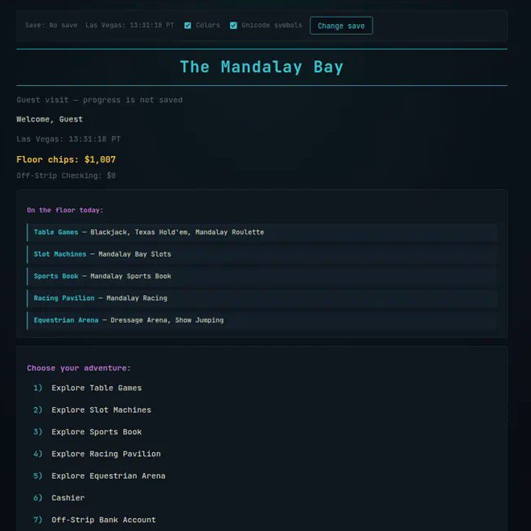
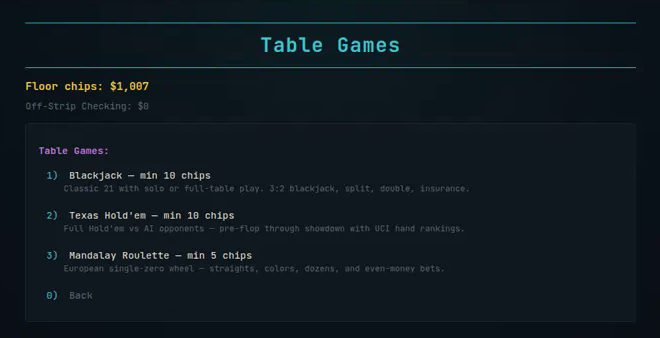

::: {.page}

[← All projects](index.qmd){.back}

::: {.project-nav}
[Case study](degen-llms.qmd){aria-current="page"} [Technical report](degen-llms/report.qmd) [Code](https://github.com/Exios66/degen-llms) [Live demo](https://exios66.github.io/degen-llms/)
:::

# The Mandalay Bay {.page-title}

[Side project · game systems & simulation]{.kicker}

The repository is called degen-llms. The name is tongue-in-cheek. There is no language model in it.

::: {.actions}
[Open the terminal](https://exios66.github.io/degen-llms/){.btn .primary} [Walk the RPG](https://exios66.github.io/degen-llms/rpg/){.btn}
:::

::: {.caveat}
**Satire only.** Chips are fictional and nothing here uses real money. This project is not affiliated with MGM Resorts International or the real Mandalay Bay.
:::

## At a glance

::: {.stats}
::: {.stat}
[3]{.stat-value} [surfaces on one wallet: Python CLI, browser terminal, pixel RPG]{.stat-label}
:::
::: {.stat}
[282 + 12]{.stat-value} [pytest tests and Node smoke scripts (CI runs 7 of the 12)]{.stat-label}
:::
::: {.stat}
[744]{.stat-value} [futures and options contracts, among 37 slot machines and 8 floors]{.stat-label}
:::
:::

## The problem

I wanted a game big enough to be a real software project: many small activities, one economy, and a save that survives. It is a resort where you pick a floor, play a game, spend chips on a room or a meal, and see the result on your balance. The joke is the setting. The work is keeping dozens of features consistent.

Two things made it hard. The game has to run as a command-line program and in a browser. And a pixel-art overworld on top must not become a third copy of every screen.

## Approach



The Python package is the reference for the rules and needs only the standard library, Python 3.11 or later. The browser terminal is a hand-written port in vanilla JavaScript ES modules. It is not Python compiled to run in the browser. The two sides share a save format, not a live store.

The pixel RPG follows one rule: it never rebuilds a game screen. Each screen is written once as a factory, `buildXRenderers(ctx)`, and both the terminal and the RPG overlay mount it. A feature added to the terminal shows up in the RPG with no RPG work. Four screens are the exception because they read better in the world: blackjack, hold'em, roulette and the House of Blues rhythm game.

## What I built

- **One wallet.** A single chip wallet is the source of truth. There are five save slots. The CLI saves to a per-user directory and the browser saves to localStorage. The web save is version 8, and a test loads a version 8 web save with RPG state in the CLI.
- **Content.** Eight floors, 37 slot machines, 337 sports scenarios, 204 prediction scenarios and 744 futures and options contracts, kept as data files.
- **A resort clock.** One clock module turns two real hours into one in-game day.
- **Exact slot maths.** The slot module can compute a machine's return by listing every three-reel combination instead of simulating spins.
- **Checks.** CI runs pytest on Python 3.11. On Node 22 it runs 7 of the 12 Node smoke scripts (the RPG world data check and six terminal-wiring scripts), a check that the browser modules' imports resolve and a browser smoke test.

## Results

{.fig fig-alt="A dark browser terminal page titled The Mandalay Bay. It shows a floor chip balance, a list of venues such as Table Games, Slot Machines and Sports Book, and a numbered Choose your adventure menu." width="100%"}

{.fig fig-alt="A dark terminal menu headed Table Games listing Blackjack, Texas Hold'em and Mandalay Roulette with minimum chips and a one-line description for each, plus a Back option." width="100%"}

These captures come from an earlier build, when the front page listed five venues. The live demo has more.

::: {.caveat}
**Heads up.** The slot machines pay more than they take on purpose. A test pins one machine's return between 155% and 185%, and exact enumeration over all 37 machines puts every one above 100% in the base game (about 168% at the low end). That is a satire economy, not realistic casino odds, and it should not be used to learn how real slots behave.
:::

## What I learned

- Writing a screen once and mounting it in two hosts removed a whole class of drift between the terminal and the RPG.
- Computing slot returns by exact enumeration gave a number a test can pin, with no sampling noise.
- Two real bugs taught me the most: an ES-module cache mismatch loaded one file twice and made two copies of its state, and a slot screen redrew the whole page every 90 ms until I changed it to update the reels in place.
- Numbers written in a README go stale quickly. The changelog and the tests held up better.

## Stack

[Python]{.tag} [JavaScript (ES modules)]{.tag} [Phaser]{.tag} [pytest]{.tag} [Node]{.tag} [GitHub Actions]{.tag} [GitHub Pages]{.tag}

:::
