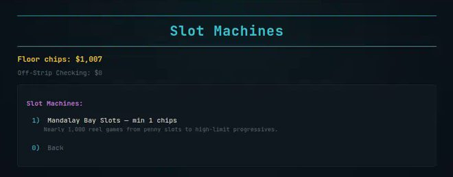
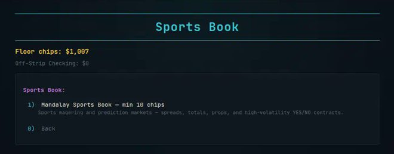

::: {.page}

[← Case study](../degen-llms.qmd){.back}

::: {.project-nav}
[Case study](../degen-llms.qmd) [Technical report](report.qmd){aria-current="page"} [Appendix](appendix.qmd) [Code](https://github.com/Exios66/degen-llms) [Live demo](https://exios66.github.io/degen-llms/)
:::

# The Mandalay Bay: technical report {.page-title}

[Side project · game systems & simulation]{.kicker}

::: {.actions}
[Open the terminal](https://exios66.github.io/degen-llms/){.btn .primary} [Walk the RPG](https://exios66.github.io/degen-llms/rpg/){.btn}
:::

## Summary

The Mandalay Bay is a satirical choose-your-adventure resort and casino simulator with one chip wallet. It runs as a Python command-line program, as a browser terminal and as a Phaser pixel-art overworld. The repository is named degen-llms as a joke. There is no language model in it. It is a systems project: one economy, three front ends, a save format that crosses them, and tests around the parts most likely to drift.

It is satire. Chips are fictional, no real money is involved, and it is not affiliated with MGM Resorts International or the real Mandalay Bay.

## System and data

### Surfaces

| Surface | Entry | Role |
| --- | --- | --- |
| Python CLI | `python3 -m mandalay_bay` | Reference rules. Standard library only at runtime, Python 3.11 or later |
| Browser terminal | `docs/index.html` | Hand-written vanilla JavaScript ES modules under `docs/js/`. Not Python compiled for the browser |
| Pixel RPG | `docs/rpg/index.html` | Phaser overworld over the same modules |

By line count (`wc`, blank lines included) `docs/js` holds about 33k lines of JavaScript, and about 44k with `docs/rpg/js` added (the RPG layer is about 10k). On main `80399bf` (30 October 2026) the repository has 27,389 lines of Python outside `docs/`, including 5,170 in `tests/` and 6,801 in `scripts/`. The runtime `mandalay_bay` package is 13,121 lines.

### Content as data

| Content | Count |
| --- | --- |
| Floors | 8 |
| Slot machines (`slots_catalog.json`) | 37 |
| Futures and options contracts | 744 |
| Sports scenarios | 337 |
| Prediction scenarios | 204 |

### Architecture



**The delegation rule.** The RPG never reimplements a game screen. Casino, hotel, pool, shops, sportsbook, racing, cashier and the meta screens are each written once in `docs/js/ui/` as a `buildXRenderers(ctx)` factory. It returns a map from view name to render function. The terminal spreads those maps into its `RENDERERS` table. The RPG's `TerminalHostOverlay` builds the same `ctx` and mounts the same functions inside an encounter panel. Four screens are drawn by the RPG itself because they read better in the world: blackjack, hold'em, roulette and the House of Blues rhythm game. They still use the shared stake picker for bet entry. The architecture note adds a direction: new logic goes in `docs/js/` first and the RPG consumes it, never the reverse.

**One wallet and the save format.** A single `ChipWallet` is the source of truth. There are five save slots. The CLI keeps them in a per-user directory and the browser keeps a library in `localStorage`. They use the same schema but are not one live store, so a save moves between them only if someone copies it. The web save is version 8, and it carries an `rpg` block with map, position and flags. The CLI reads the version field tolerantly.

**The resort clock.** `world-cycle.js` is the single clock for the resort. Two real hours equal one in-game day, which it divides into four named phases.

### Randomness

The core table games and slots use a cryptographically secure generator. In Python that is a `secrets.SystemRandom` singleton, with Fisher–Yates shuffles for decks. In the browser the game modules draw from `crypto.getRandomValues`. A seeded generator is injected only in tests, so those tests are repeatable.

One gap: the repository documentation says gameplay never uses `Math.random`, and that is not true. I grepped `docs/js` and `docs/rpg/js` and found 30 calls in 14 files. Several side-venue rolls that change chips or rewards still use it: the tip-back roll and amounts in the Gentleman's Club (`gentlemans-club.js`), the bar encounter roll (`bar.js`), dining encounters (`dining.js`) and the pit top-up perk (`rewards-perks.js`). The arcade cabinets, the Strip Drive game and the rhythm overlay use it for spawns and sequences. The rest is cosmetic: dealer quips, message ids, effects and animation timing. The claim is wrong as written.

### Exact slot returns

`estimate_base_game_rtp` in `mandalay_bay/activities/slots.py` does not simulate spins. It loops over every combination of symbols on the three reels. It multiplies the three symbol probabilities, runs the real payout function on that combination and sums probability times win. It returns the return to player and the hit frequency, excluding progressives. The result is exact, so a test can assert on it with no tolerance for sampling noise.

The numbers are not realistic. A test named for the parody machine `fortune` pins its return between 155% and 185%, with a hit frequency of at least 28%. I also ran the estimator over all 37 machines in the catalog. Every one returns more than 100% in the base game: the lowest are `fortune` and `high_roller` at about 168%, and the highest is a salon machine at about 1,049%. Hit frequency ranges from about 4% to about 36%. These machines pay the player on average. That is the satire. Nothing here models real casino odds.

## Iteration history

The changelog itself still ends at 1.2.2 (2026-08-26). Merged pull requests now run through #160, and the changelog does not yet have entries for #158–#160, so this page does not claim that it does. I did not count commits.

::: {.timeline}
- **1.1.0, 2026-07-26** — Trading Floor with 744 stored contracts, 337 sports events and 204 prediction scenarios, Arcade Alley cabinets, Vegas Strip Drive, craps and a lottery counter, and the walkable Strip overworld in the RPG. Rewards tier thresholds aligned to the docs: saves keep their lifetime totals and the tier is recomputed, so a player who had maxed the old ladder can drop until they wager more. Valet garage exit softlock fixed.
- **1.2.0, 2026-07-27** — Gentleman's Club, resort dining and first-person bar overlays, the Mandalay Beach pool overlay, Strip Ride to away casinos, Rewards Phone audio and the Shoppes expansion. Fixes include the module cache bug, the slot redraw bug, tier gate syncing and a Strip Ride blank-screen crash (missing `menuBtn` helper).
- **1.2.1, 2026-07-27** — Distinct accent colours and table skins for the away-casino menus (Luxor, Excalibur, Bellagio, Circa), plus documentation parity.
- **1.2.2, 2026-08-26** — Python CLI parity for gambling, including text-mode Arcade Alley and the 37-machine slots catalog, and an Arcade Alley redeem shop whose perks feed the casino (a free-spin voucher, a welcome-drink refill). Fixes from a web-terminal casino audit (pending refunds on leave, in-flight slot and roulette spins) and from a pass over RPG hosted games and overlays, and a second `menuBtn` crash fix in the strip-limo screen.
:::

### Bugs worth naming

- **Module cache skew.** The casino boot path loaded `venues.js` more than once because of ES-module cache skew, which duplicated its instances. The changelog lists it as fixed. I did not trace the fix itself.
- **Slot redraw.** The slot screen replaced the whole page every 90 ms while the reels spun, which glitched the spin. It now updates the reels in place.
- **Valet garage softlock.** The changelog describes a softlock when leaving the valet garage. It was fixed with wayfinding signs, path ramps and an interactive keys desk.

## Results

There are no performance benchmarks. The evidence is the test suite, the CI run list and the screenshots below.

### Test counts

These are collected, not pass rates. I did not run the suite for this report.

| Suite | Count | Source |
| --- | --- | --- |
| pytest | 379 `def test_` functions in 52 files under `tests/` | line-start grep on `80399bf`, not a fresh `pytest --co` |
| Node scripts | 13 `scripts/smoke-test-*.mjs` and 5 `scripts/test-*-regressions.mjs` | 18 scripts on `80399bf` |
| Browser smoke test | 1 script | `scripts/smoke-test-web.py` |

CI (`.github/workflows/checks.yml`) runs pytest on Python 3.11. The Node job loops over every `scripts/smoke-test-*.mjs` and `scripts/test-*-regressions.mjs`, then runs the browser smoke test. The old "7 of 12" description is obsolete. The live Pages build is deployed by hand from `gh-pages`, so the demo can lag main. It was not re-checked for drift on 30 October 2026.

`tests/test_save_version_migration.py` covers a version 3 save with no rewards state, version 7 tier fields, and a version 8 web save with an `rpg` block loading in the CLI.

## Figures

{.fig fig-alt="A dark browser terminal page titled The Mandalay Bay with a floor chip balance, a list of five venues and a numbered Choose your adventure menu." width="100%"}

{.fig fig-alt="A terminal menu headed Table Games listing Blackjack, Texas Hold'em and Mandalay Roulette, each with a minimum bet and a one-line description." width="100%"}

{.fig fig-alt="A terminal menu headed Slot Machines with one entry, Mandalay Bay Slots, minimum 1 chip, and a Back option." width="100%"}

{.fig fig-alt="A terminal menu headed Sports Book with one entry, Mandalay Sports Book, minimum 10 chips, described as spreads, totals, props and yes or no contracts, and a Back option." width="100%"}

These screenshots come from an earlier build. The slot screen's text there ("nearly 1,000 reel games") does not match the 37-machine catalog in the current data.

## Reproducibility

```sh
python3 -m mandalay_bay                   # play the CLI
python3 -m mandalay_bay --list-saves      # list save slots
python3 -m pytest                         # Python tests
node scripts/validate-docs-imports.mjs    # check browser module imports
node scripts/smoke-test-rpg.mjs           # RPG world data check
```

The browser terminal is static files in `docs/`, so any static host can serve it. Playing cards in the games use the Kenney Playing Cards Pack (kenney.nl), released under CC0.

## Engineering quality

- **Tests near the economy.** Wallet, rewards, saves, hotel, sportsbook, lottery and slots each have their own test file.
- **Import validation.** A script walks the browser modules and fails if an import does not resolve.
- **Tolerant saves.** The CLI accepts newer web saves instead of refusing them.
- **No runtime dependencies in Python.** The package needs only the standard library.

## Limitations and next steps

- The README still says "200+ tests". It no longer says "14 slot machines". The gap to the grep count above is larger than it was when this note said both. The data files still give 37 slot machines.
- Package metadata says version 1.0.0 while the changelog is at 1.2.2.
- The Pages deploy is manual from the `gh-pages` branch, so the live demo can lag `main`.
- Blackjack rule tests are small: `test_rules.py` has 9 tests and `test_hand.py` has 8.
- Slot returns are parody numbers, not realistic odds.
- The `Math.random` calls in side-venue code (tips, bar, dining, rewards perk), described above, are a known gap against the project's own claim.
- Python and the browser each implement the rules, so they can drift. The shared save schema and tests reduce that risk but do not remove it.

:::
