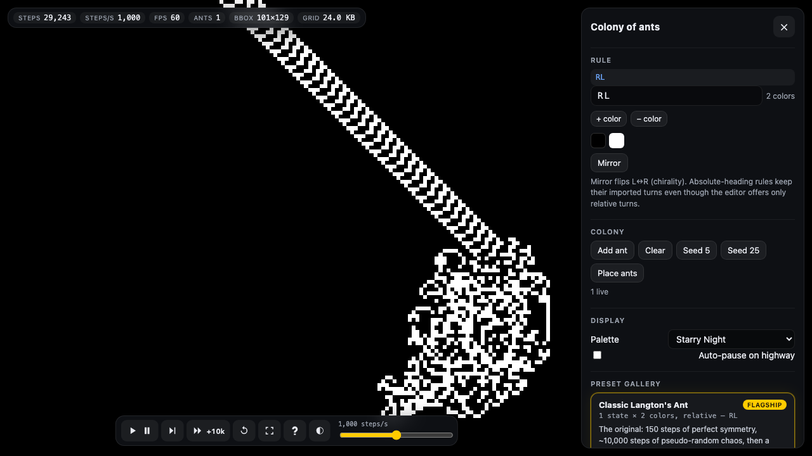

::: {.page}

[← All projects](index.qmd){.back}

::: {.project-nav}
[Case study](langtons-ant.qmd){aria-current="page"} [Code](https://github.com/Exios66/langtons-ant) [Live demo](https://exios66.github.io/langtons-ant/)
:::

# Langton's Ant {.page-title}

[Side project · simulation in the browser · version 0.1.0]{.kicker}

A browser simulator for Langton's ant and the wider family of two-dimensional Turing machines called turmites. I wrote the engine, the renderer and the interface. The mathematics of what these machines do comes from the literature listed at the bottom of this page, not from me.

::: {.actions}
[Open the simulator](https://exios66.github.io/langtons-ant/){.btn .primary} [View the code](https://github.com/Exios66/langtons-ant){.btn}
:::

## At a glance

::: {.stats}
::: {.stat}
[99]{.stat-value} [passing tests in 9 files, covering the engine, the permalink and session code, and the presets; a throughput benchmark is skipped unless asked for]{.stat-label}
:::
::: {.stat}
[20]{.stat-value} [preset machines in the gallery, each with its notation and a source]{.stat-label}
:::
::: {.stat}
[64 × 64]{.stat-value} [cells per grid chunk, one byte per cell, so 4 KiB a chunk]{.stat-label}
:::
:::

## The problem

In 1986 Christopher Langton described an ant on a grid of cells. On a blank cell it turns right, paints the cell and steps forward; on a painted cell it turns left, clears the cell and steps forward. For about ten thousand steps the result looks like noise. Then the ant starts building a diagonal road that repeats every 104 steps and goes on forever. Whether this always happens is the open Highway Conjecture. Generalized ants, with more colors and more internal states, are called turmites, and some of them have been proved to be universal computers.

The goal of the project is to run any of these machines in a browser, on a grid with no edge, deterministically, and to make a run something you can link to. Each of those three requirements shaped the code.

## Approach



The app is TypeScript built with Vite. It has no runtime dependencies, only development tools. The code is split into three folders. `src/engine` holds the rule tables, the grid and the stepper, and nothing in it touches the browser, so the same code runs in the page and under Vitest in Node. `src/render` paints the grid, and `src/app` runs the animation loop, the panels and the permalinks.

A rule is one flat table indexed by state and color. For each pair it gives the color to write, the turn to make and the next state, so the classic ant is one state and two colors and a turmite is more of each. The engine accepts up to 32 colors and 16 states, in three notations: ant strings such as `RL` or `LLRR`, tables of triples in the style of the GollyGang Rule Table Repository, and decimal IDs. It refuses rule codes that would make an ant split in two, rather than guess at them. With more than one ant, every ant acts on every step, in array order.

## Engineering decisions

- **Chunked typed arrays, not a sparse map.** The grid is a map from chunk coordinates to 64 × 64 `Uint8Array` chunks, created the first time a cell in them is written. Chunk coordinates are packed into one number so that long highways do not collide. The design notes argue that a map entry per cell would use far more memory than chunks. The repository does not measure that comparison.
- **One thread, on purpose.** Sharing memory with a worker needs the `COOP` and `COEP` response headers, and GitHub Pages cannot send them. So the simulation runs on the main thread, and the code contains no worker.
- **Repaint only what changed.** Every step records the cell it wrote. The renderer keeps an offscreen texture at one pixel per cell and updates only those cells: one small write per cell up to 512 changes in a frame, and above that a repaint of the touched chunks with buffers that are reused rather than reallocated. The visible canvas then gets one scaled draw of the texture. The grid is unbounded, but the texture is capped at about 16.7 million pixels; past that it re-centers on recent activity.
- **Determinism you can test.** The step function is integer-only, and the engine never calls `Math.random`. The one source of randomness, placing stray ants, goes through a seeded generator (mulberry32). A single test runs the classic ant for 11,000 steps from a blank grid and compares an FNV-1a hash of the visited region with a committed value, `6219b3fb`. That one assertion covers integer stepping, chunk addressing across negative coordinates, and the rule table.
- **Permalinks in the URL hash.** The hash carries the rule, the ants, the step count, the camera, the palette and the seed (`#r=…&a=…&i=…&s=…&z=…&c=…&x=…`). It never goes to a server. When the run-length encoding of the grid is at most 900 characters, the grid rides along too.

## What I built

- **The engine.** Rule parsers and encoders for the three notations, the chunked grid, the stepper, the PRNG and the hash.
- **The renderer and interface.** A Canvas2D renderer with pan and zoom, a rule editor, palettes, a dark and a light theme, keyboard shortcuts, PNG and WebM export, and session export as JSON.
- **A preset gallery.** Twenty machines, each with its notation, a one-line milestone where one is known and a link to its source: the classic ant, ants with three to twelve colors, ants whose highways have been proved, two turmites that stay chaotic for millions of steps, halting machines and absolute-heading turmites.
- **Tests.** Ninety-nine Vitest tests across the rule parsers, the grid, the simulation, serialization, the highway detector, session restore, the preset gallery and the golden hash, and a type-check that passes.

## Results

{.fig fig-alt="A screenshot of the simulator in its dark theme. On the black canvas, a diagonal road of repeating black and white cells runs from the top edge down and to the right until it meets an irregular white cluster in the lower middle. A bar along the top reads steps 15,181, steps per second 1,000, frames per second 60, ants 1, bounding box 119 by 147 and grid 24.0 KB. A panel on the right shows the rule RL with two colors, colony and display controls, and the first card of the preset gallery, Classic Langton's Ant." width="100%"}

The irregular cluster is the first ten thousand or so steps. The road is the highway. The 24.0 KB in the top bar is six 4 KiB chunks. A replay of the classic ant without a browser checks its numbers: it settles into a 104-step cycle that moves it two cells along each axis, from about step 9,976, which matches the figure of about 9,977 steps in the gallery's milestone.

The repository's README reports how fast the engine steps in Node. Those numbers come from one laptop. The same benchmark re-run on a different machine shows how much they depend on it.

| 1,000,000 steps per run, mean of 5 | README: Apple M2, macOS, Node 22.14.0 | Re-runs: shared 4-core Linux container, Node 22.22.0 |
| --- | --- | --- |
| Classic `RL` ant, one ant | 19.65 million steps per second | 4.28, 10.63 and 13.18 million in three re-runs |
| Colony of 25 ants | 0.54 million steps per second, 13.39 million cell updates per second | 0.19, 0.29 and 0.31 million in three re-runs |

: Engine throughput in Node, with no browser and no rendering. The benchmark logs its timings and asserts nothing, so throughput never fails a test. These are not browser frame rates, which have not been measured.

The throughput depends heavily on the machine, and it varied by a factor of three between runs on the same shared container, so treat the README's figures as one laptop's result. The determinism test does not depend on the machine: the 11,000-step hash also passes on the Linux re-run.

## Where the mathematics comes from

None of the following is my work. They are the papers this project's README cites for its claims.

- Langton, C. G., "Studying artificial life with cellular automata," *Physica D* 22 (1986): [the original paper](https://deepblue.lib.umich.edu/bitstream/2027.42/26022/1/0000093.pdf).
- Gajardo, Moreira and Goles, "Complexity of Langton's ant," *Discrete Applied Mathematics* 117 (2002): [arXiv](https://arxiv.org/abs/nlin/0306022).
- Gajardo, Hellouin de Menibus, Maldonado and Moreira, "Nontrivial Turmites Are Turing-Universal" (2017): [arXiv](https://arxiv.org/abs/1702.05547).
- Gajardo, Lutfalla and Rao, "Ants on the highway," *Natural Computing* (2025): [arXiv](https://arxiv.org/abs/2409.10124).
- Lutfalla, "Sideways on the highways" (2025): [arXiv](https://arxiv.org/abs/2505.05426), and "The LLLR generalised Langton's ant" (2025): [arXiv](https://arxiv.org/abs/2506.10482).
- The GollyGang [Rule Table Repository](https://github.com/GollyGang/ruletablerepository/wiki/TwoDimensionalTuringMachines), the source of the rule notation and of many gallery machines.

## Stack

[TypeScript]{.tag} [Vite]{.tag} [Canvas2D]{.tag} [Vitest]{.tag}

:::
