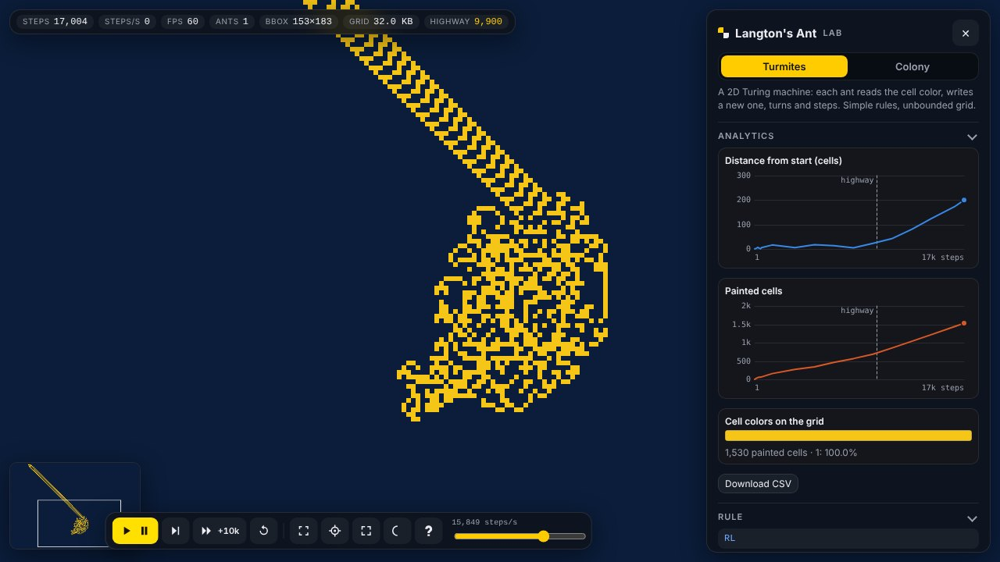

::: {.page}

[← All projects](index.qmd){.back}

::: {.project-nav}
[Case study](langtons-ant.qmd){aria-current="page"} [Appendix](langtons-ant/appendix.qmd) [Code](https://github.com/Exios66/langtons-ant) [Live demo](https://exios66.github.io/langtons-ant/)
:::

# Langton's Ant {.page-title}

[Side project · simulation in the browser · version 0.1.0]{.kicker}

A browser simulator for Langton's ant and the wider family of two-dimensional Turing machines called turmites, with a second mode in which many ants forage, recruit and fight through evaporating pheromone trails. I wrote the engines, the renderers and the interface. The mathematics of what turmites do comes from the literature listed at the bottom of this page, not from me.

::: {.actions}
[Open the simulator](https://exios66.github.io/langtons-ant/){.btn .primary} [View the code](https://github.com/Exios66/langtons-ant){.btn}
:::

## At a glance

::: {.stats}
::: {.stat}
[108]{.stat-value} [passing unit tests in 11 files, plus 8 end-to-end checks that drive the built app in Chromium; a throughput benchmark is skipped unless asked for]{.stat-label}
:::
::: {.stat}
[20]{.stat-value} [preset machines in the gallery, each with its notation and a source]{.stat-label}
:::
::: {.stat}
[5]{.stat-value} [colony scenarios, from one nest foraging to a four-way war, each replayable from its seed]{.stat-label}
:::
:::

## The problem

In 1986 Christopher Langton described an ant on a grid of cells. On a blank cell it turns right, paints the cell and steps forward; on a painted cell it turns left, clears the cell and steps forward. For about ten thousand steps the result looks like noise. Then the ant starts building a diagonal road that repeats every 104 steps and goes on forever. Whether this always happens is the open Highway Conjecture. Generalized ants, with more colors and more internal states, are called turmites, and some of them have been proved to be universal computers.

The goal of the project is to run any of these machines in a browser, on a grid with no edge, deterministically, and to make a run something you can link to. Each of those three requirements shaped the code. The colony mode asks the opposite question: what many ants build when they share a memory that fades, instead of one ant writing on a grid that never forgets.

## Approach



The app is TypeScript built with Vite. It has no runtime dependencies, only development tools. The code is split into four folders. `src/engine` holds the rule tables, the grid and the stepper, and `src/colony` holds the colony simulation and its scenarios. Neither touches the browser, so the same code runs in the page and under Vitest in Node. `src/render` paints both simulations, and `src/app` runs the animation loop, the panels, the live charts and the permalinks.

A rule is one flat table indexed by state and color. For each pair it gives the color to write, the turn to make and the next state, so the classic ant is one state and two colors and a turmite is more of each. The engine accepts up to 32 colors and 16 states, in three notations: ant strings such as `RL` or `LLRR`, tables of triples in the style of the GollyGang Rule Table Repository, and decimal IDs. It refuses rule codes that would make an ant split in two, rather than guess at them. With more than one ant, every ant acts on every step, in array order.

## Engineering decisions

- **Chunked typed arrays, not a sparse map.** The grid is a map from chunk coordinates to 64 × 64 `Uint8Array` chunks, created the first time a cell in them is written. Chunk coordinates are packed into one number so that long highways do not collide. The [repository's memory comparison](https://github.com/Exios66/langtons-ant/blob/fc52838bac6683bb8d2af9c9ac76defbdcc1fc58/scripts/memory-compare.ts) now reports one 20-million-step run per rule: a per-cell map used about 32× the chunk bytes for RLR, 34× for LLRR and 6× for the classic ant. These are pattern-specific measurements, not a universal memory ratio.
- **One thread, on purpose.** Sharing memory with a worker needs the `COOP` and `COEP` response headers, and GitHub Pages cannot send them. So the simulation runs on the main thread, and the code contains no worker.
- **Repaint only what changed.** Every step records the cell it wrote. The renderer keeps an offscreen texture at one pixel per cell and updates only those cells: one small write per cell up to 512 changes in a frame, and above that a repaint of the touched chunks with buffers that are reused rather than reallocated. The visible canvas then gets one scaled draw of the texture. The grid is unbounded, but the texture is capped at about 16.7 million pixels; past that it re-centers on recent activity.
- **Determinism you can test.** The step function is integer-only, and the engine never calls `Math.random`. The one source of randomness, placing stray ants, goes through a seeded generator (mulberry32). A single test runs the classic ant for 11,000 steps from a blank grid and compares an FNV-1a hash of the visited region with a committed value, `6219b3fb`. That one assertion covers integer stepping, chunk addressing across negative coordinates, and the rule table.
- **Permalinks in the URL hash.** The hash carries the rule, the ants, the step count, the camera, the palette and the seed (`#r=…&a=…&i=…&s=…&z=…&c=…&x=…`). It never goes to a server. When the run-length encoding of the grid is at most 900 characters, the grid rides along too.

## Colony mode

The second mode, opened from the Colony tab, replaces the grid-writing ant with hundreds of ants that move continuously and write pheromones instead of colors. Searching ants lay a home scent and follow food scent; ants carrying food lay food scent and follow home scent, which closes the foraging loop. Both fields evaporate and diffuse, so a trail that is not reinforced fades, and a shorter path, walked more often, wins over a longer one.

Each colony has workers, scouts and soldiers. Delivered food goes into the nest store, ants eat from it, and the store pays for new ants. Ants die of hunger, age or combat, and the dead become food. Rival colonies that meet fight and mark the spot with alarm pheromone, which draws soldiers, and a colony under attack raises more of them. Five scenarios set the stage: foraging trails, Deneubourg's double bridge, two rivals, a four-way war and a maze. Food and walls can be painted in while a run is going, and sliders change evaporation, diffusion, wander, regrowth and aggression live.

{.fig fig-alt="A screenshot of colony mode in the dark theme. A walled rectangular arena holds a large yellow-green food patch in the center, smaller patches near the edges and grey wall segments around the center. Four colonies, one in each corner, have laid glowing trails in blue, red, green and amber that run to the food patches. A bar along the top reads ticks 1,111, frames per second 28, ants 327 and food left 11,037. The panel on the right shows the Four-way war scenario, its seed, and a live chart of ants alive per colony, starting at 100 each and drifting between 60 and 100." width="1280" height="720"}

The colony simulation draws from one seeded generator in a fixed order, so a scenario and seed replay identically in the same browser engine. Unlike the turmite engine it uses floating-point trigonometry, so identical results across different engines are not guaranteed, and a colony link carries only the scenario and the seed, not walls or food painted during the run.

## What I built

- **The turmite engine.** Rule parsers and encoders for the three notations, the chunked grid, the stepper, the PRNG and the hash.
- **The colony simulation.** Continuous-motion ants steering by three forward sensors, home, food and alarm pheromone fields, castes whose mix adapts to fighting and to food income, a nest economy, combat between colonies and five scenarios.
- **The renderers and interface.** Canvas2D views for both modes with pan and zoom, oriented ant markers, afterglow on freshly written cells, grid lines when zoomed in, an overview minimap, a follow camera, a rule editor, palettes, a dark and a light theme, keyboard shortcuts, PNG and WebM export, and session export as JSON.
- **Live analytics.** Charts with a hover read-out and CSV download: for a turmite, distance from the start and painted cells against steps, with the highway onset marked, and the share of each cell color; for colonies, ants alive, food in each nest store, caste split and a ledger of births and deaths. A series keeps at most 512 points by dropping every other point when it fills, so a run of any length fits.
- **A preset gallery.** Twenty machines, each with its notation, a one-line milestone where one is known and a link to its source: the classic ant, ants with three to twelve colors, ants whose highways have been proved, two turmites that stay chaotic for millions of steps, halting machines and absolute-heading turmites.
- **Tests.** 108 Vitest tests across the rule parsers, the grid, the simulation, serialization, the highway detector, session restore, the preset gallery, the golden hash, the colony simulation and the chart axis labels, and a type-check that passes. Eight Playwright checks drive the production build in Chromium and fail on any page or console error: the start view, drawing an ant added while paused, the highway badge, mode switching, every colony scenario, colony links, the paint cursor and an unbroken wall from a fast drag.

## Results

{.fig fig-alt="A screenshot of turmite mode in the dark theme. On a deep navy canvas, a diagonal road of repeating gold cells runs from the top edge down to an irregular gold cluster in the middle. A bar along the top reads steps 17,004, frames per second 60, ants 1, bounding box 153 by 183, grid 32.0 KB and highway 9,900. The panel on the right shows two line charts against steps, distance from start in cells and painted cells, each with a dashed vertical line labelled highway where the distance curve turns from flat to steeply rising, and a bar of cell colors reading 1,530 painted cells. An overview map sits in the lower left." width="1280" height="720" loading="lazy"}

The irregular cluster is the first ten thousand or so steps. The road is the highway, and the distance chart shows the change: the ant wanders within about 20 cells of its start, then moves away at a steady rate once the road begins. The 32.0 KB in the top bar is eight 4 KiB chunks. A replay of the classic ant without a browser checks the numbers: it settles into a 104-step cycle that moves it two cells along each axis, from about step 9,976. The detector's estimate of 9,900 is close, but it is a drift heuristic, not a proof that the motion is periodic, and the README says it can flag steady drift that is not exactly periodic.

The repository's README reports how fast the engine steps in Node. Those numbers come from one laptop. The same benchmark re-run on a different machine shows how much they depend on it.

::: {.chart kind="strip" title="Engine speed in Node, million steps per second: README figure against three re-runs" label="1,000,000 steps per run, mean of 5" from="README: Apple M2, macOS, Node 22.14.0" to="Re-runs: shared 4-core Linux container, Node 22.22.0" from-mode="first" to-mode="all" from-name="README (Apple M2 laptop)" to-name="Re-runs (shared Linux container)" unit="M"}
| 1,000,000 steps per run, mean of 5 | README: Apple M2, macOS, Node 22.14.0 | Re-runs: shared 4-core Linux container, Node 22.22.0 |
| --- | --- | --- |
| Classic `RL` ant, one ant | 19.65 million steps per second | 4.28, 10.63 and 13.18 million in three re-runs |
| Colony of 25 ants | 0.54 million steps per second, 13.39 million cell updates per second | 0.19, 0.29 and 0.31 million in three re-runs |

: Engine throughput in Node, with no browser and no rendering. The benchmark logs its timings and asserts nothing, so throughput never fails a test. These are not browser frame rates, which have not been measured.
:::

The throughput depends heavily on the machine, and it varied by a factor of three between runs on the same shared container, so treat the README's figures as one laptop's result. The determinism test does not depend on the machine: the 11,000-step hash also passes on the Linux re-run.

## Where the mathematics comes from

None of the following is my work. They are the papers this project's README cites for its claims.

- Langton, C. G., "Studying artificial life with cellular automata," *Physica D* 22 (1986): [the original paper](https://deepblue.lib.umich.edu/bitstream/2027.42/26022/1/0000093.pdf).
- Gajardo, Moreira and Goles, "Complexity of Langton's ant," *Discrete Applied Mathematics* 117 (2002): [arXiv](https://arxiv.org/abs/nlin/0306022).
- Gajardo, Hellouin de Menibus, Maldonado and Moreira, "Nontrivial Turmites Are Turing-Universal" (2017): [arXiv](https://arxiv.org/abs/1702.05547).
- Gajardo, Lutfalla and Rao, "Ants on the highway," *Natural Computing* (2025): [arXiv](https://arxiv.org/abs/2409.10124).
- Lutfalla, "Sideways on the highways" (2025): [arXiv](https://arxiv.org/abs/2505.05426), and "The LLLR generalised Langton's ant" (2025): [arXiv](https://arxiv.org/abs/2506.10482).
- The GollyGang [Rule Table Repository](https://github.com/GollyGang/ruletablerepository/wiki/TwoDimensionalTuringMachines), the source of the rule notation and of many gallery machines.

## Stack

[TypeScript]{.tag} [Vite]{.tag} [Canvas2D]{.tag} [Vitest]{.tag}

:::
