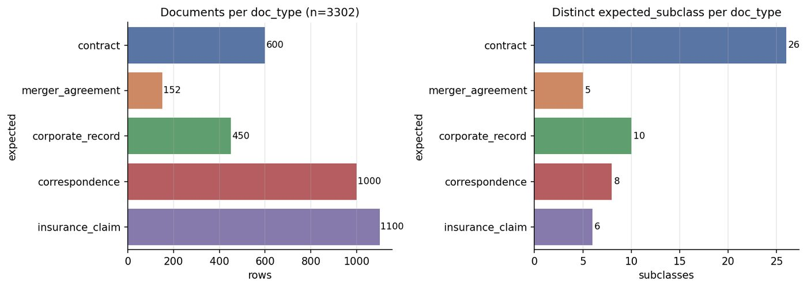
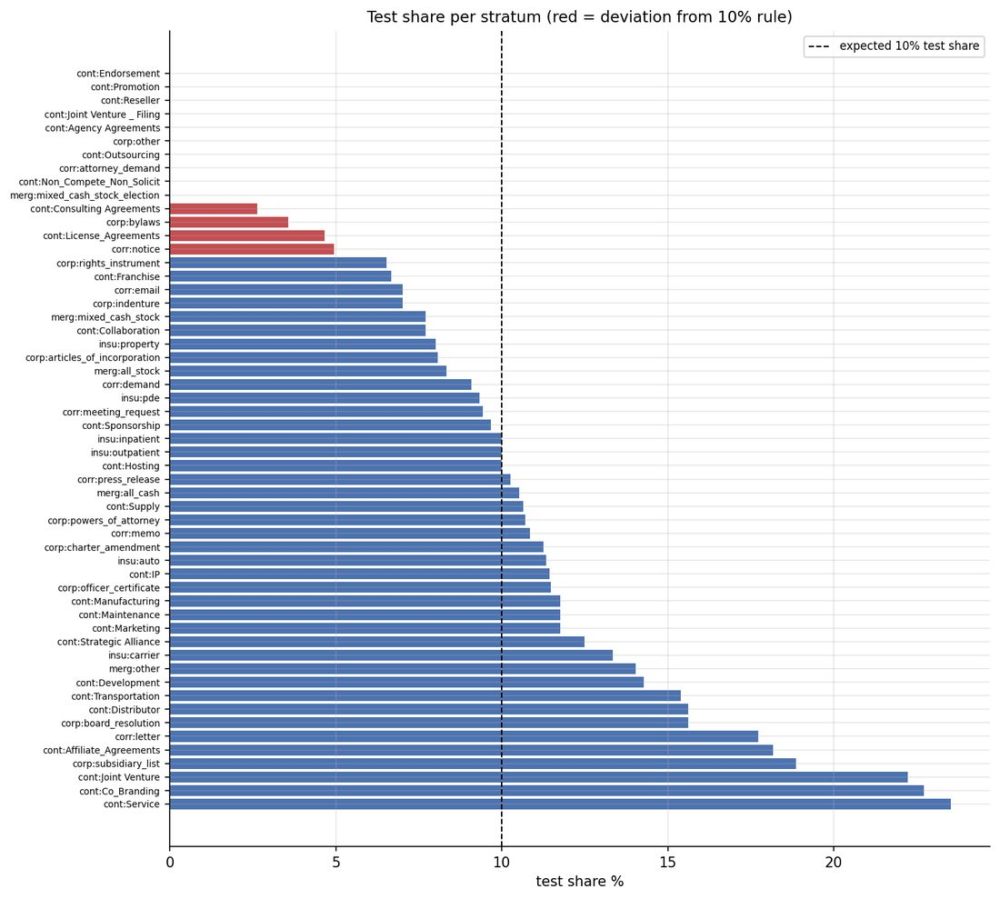

::: {.page}

[← All projects](index.qmd){.back}

::: {.project-nav}
[Case study](mailroom-corpus-eda.qmd){aria-current="page"} [Technical report](mailroom-corpus-eda/report.qmd) [Code](https://github.com/Exios66/Mailroom-Corpus-EDA) [Dataset](https://huggingface.co/datasets/Lucius-Morningstar/mailroom-dataset)
:::

# Mailroom-Corpus-EDA {.page-title}

[Data engineering · dataset build, audit & publishing]{.kicker}

The mailroom projects all depend on one dataset. This repository is how I built it from public sources, cleaned it, checked it, and published it without letting the labels leak.

::: {.actions}
[View the code](https://github.com/Exios66/Mailroom-Corpus-EDA){.btn .primary} [Dataset on Hugging Face](https://huggingface.co/datasets/Lucius-Morningstar/mailroom-dataset){.btn}
:::

## At a glance

::: {.stats}
::: {.stat}
[3,302]{.stat-value} [documents in 5 classes and 55 strata, from CUAD, MAUD, SEC EDGAR, Enron email and four insurance sources]{.stat-label}
:::
::: {.stat}
[13,753 of 13,753]{.stat-value} [contract clause annotations whose character offsets match the document text exactly]{.stat-label}
:::
::: {.stat}
[7]{.stat-value} [pipeline phases, from download to a correspondence-intent audit, rerun with one command]{.stat-label}
:::
:::

## The problem

I could not find a public dataset that looks like a mailroom: contracts, merger agreements, corporate filings, emails and insurance claims arriving together. The only way to get one was to assemble it from sources that were never meant to sit side by side. They differ in format, licence, labelling, length and quality.

Assembling the pieces is the smaller job. The harder part is being able to say, for every document, where it came from, what its label means, who produced the label, and whether a model scored on it could have seen the answer.

## Approach



The dataset is built once from public sources, and then the repository audits the published result. Every phase works from the published data, downloaded from the Hugging Face Hub, and recomputes its numbers, so the report is a check on the dataset and not a description of it.

The design rule that shaped the most work is label separation. The main configuration a model reads has four columns: a filename, the document text, a prompt and a metadata blob. It has no label column. All ground truth lives in a second configuration that is joined on filename. A model working on the first configuration cannot see an expected class, an intent or a clause annotation.

## What I built

- **Sources, with licences tracked.** Contracts from CUAD and SEC EDGAR exhibits, merger agreements from MAUD, corporate records from EDGAR filings, correspondence from a deduplicated Enron corpus, and insurance claims from four sources, all recorded as synthetic. I left out three candidate insurance samples because they carry a non-commercial licence.
- **Identity and provenance.** Each row has a stable document id, derived from its source and filename and not from its row position, plus content hashes. A rebuild changes none of them. Each label also records how it was produced: a verified join, a model, a person, a heuristic, source-native, or synthetic.
- **Fixing correspondence intent.** Many email rows had no intent label. I hydrated them by an exact match on a hash of the normalised body against a larger Enron corpus and against AESLC, ran a constrained model pass on the rest, and recorded which path produced each label. All 1,000 rows now have one of eight intents.
- **Hardened export.** The exporter keeps metadata types uniform and handles the Unicode line separators that break JSON Lines readers. A byte-verify script compares a local export against what is on the Hub.
- **An audit pipeline.** Integrity, composition, 30 static figures, 18 interactive figures, 17 tables, and a summary report, all rerunnable.
- **Tests.** About 200 test functions cover identity, the integrity audit, ground-truth quality rules, fixtures and the revision builders.

## Results

{.fig fig-alt="Two horizontal bar charts over the five document classes. Left: documents per class, with insurance claims at 1,100, correspondence at 1,000, contracts at 600, corporate records at 450 and merger agreements at 152. Right: distinct subclasses per class, with contracts at 26, corporate records at 10, correspondence at 8, insurance claims at 6 and merger agreements at 5." width="100%"}

The corpus is imbalanced, and the audit says so plainly. The largest class is 7.2 times the smallest. At the level of the 55 strata the ratio is 557, because one merger-agreement stratum has a single document. The split rule puts a document in the test set when the md5 of its filename modulo 10 is zero, which is reproducible but not stratified. Ten strata end up with no test documents.

{.fig fig-alt="Horizontal bars of test-set share for each of the 55 strata with a dashed line at 10%. Ten strata at the top have no test documents, four more, drawn in red, fall well short of it, and the rest run from about 6% to 24%." width="100%"}

::: {.caveat}
**Heads up.** The dataset is built for evaluating a mailroom pipeline. It is not a training set, and its 90/10 split is a way to sample reproducibly, not a train and test design. The 91 SEC EDGAR contracts have no clause annotations. The Enron emails are real messages from named people, so I handle them conservatively, and any use of them should too.
:::

## What I learned

- Once a dataset has several sources, provenance is part of the data. Recording how each label was made turned "this is 100% filled" into a claim I could check.
- A published report can be wrong without anything crashing. After I moved a count out of the blind metadata to stop it leaking, the audit kept reading the old location and reported 0 of 152 consistent. It had been checking the wrong place, not finding a bug in the data. I fixed the audit and added a test.
- Deterministic builds pay for themselves. Because a rebuild gives the same bytes, a change that should not touch any row is something I can prove, not something I hope.
- Public sources need unglamorous work: checking licences, handling odd characters, and writing down the known gaps instead of hiding them.

## Stack

[Python]{.tag} [pandas]{.tag} [PyArrow]{.tag} [Hugging Face Hub]{.tag} [Plotly]{.tag} [matplotlib]{.tag} [pytest]{.tag}

:::
