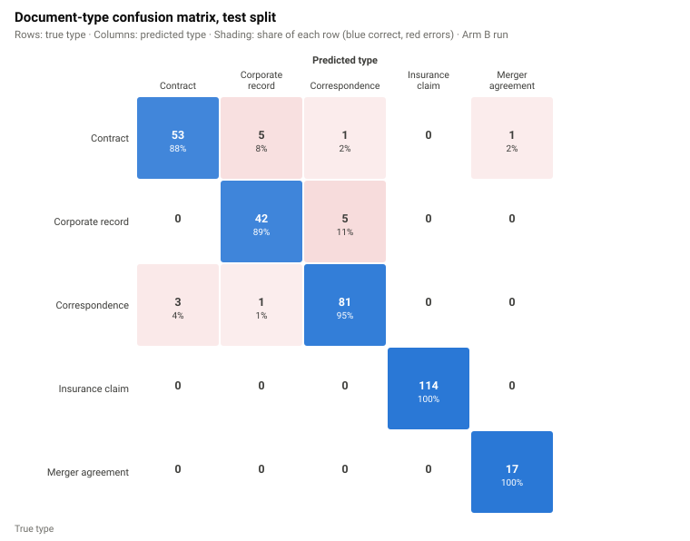
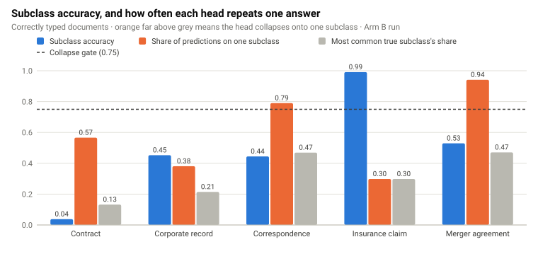

::: {.page}

[← All projects](index.qmd){.back}

::: {.project-nav}
[Case study](mailroom-ml.qmd){aria-current="page"} [Technical report](mailroom-ml/report.qmd) [Appendix](mailroom-ml/appendix.qmd) [Code](https://github.com/LLM-Mailroom-Services/mailroom-ml) [Model](https://huggingface.co/Lucius-Morningstar/mailroom-modernbert-classifier/tree/m9c-20261014-113614) [Training data](https://huggingface.co/datasets/Lucius-Morningstar/mailroom-modernbert-training)
:::

# Mailroom-ML {.page-title}

[ML training, evaluation & calibration]{.kicker}

## At a glance

::: {.stats}
::: {.stat}
[95.98%]{.stat-value} [M9c document-type accuracy on 323 test documents (310 correct)]{.stat-label}
:::
::: {.stat}
[0.0189]{.stat-value} [M9c window calibration error (ECE), not document-level calibration]{.stat-label}
:::
::: {.stat}
[39.01%]{.stat-value} [M9c confidence-only acceptance upper bound (126 of 323); not production fast-path coverage]{.stat-label}
:::
::: {.stat}
[4 of 4]{.stat-value} [M9c release gates met; this does not certify every subclass]{.stat-label}
:::
:::

The current published release is **M9c (`m9c-20261014-113614`)**, reviewed on 6 November 2026 against [the source README at 01c2272](https://github.com/LLM-Mailroom-Services/mailroom-ml/blob/01c2272f7ee6625b9196c25095346812d39d42ff/README.md) and its [held-out test report](https://github.com/LLM-Mailroom-Services/mailroom-ml/blob/01c2272f7ee6625b9196c25095346812d39d42ff/reports/TEST-EVAL/TEST-EVAL-REPORT-m9c-20261014-113614.md). Conditional subclass accuracy is 229 of 310 scorable documents (73.87%). The 39.01% confidence-only figure omits support, catch-all, head-exclusion and subclass-projection guards; the full gate can accept fewer documents. Contract and correspondence remain excluded from fast-path routing by checkpoint policy.

The M9b results below and the [technical report](mailroom-ml/report.qmd) preserve the earlier experiment history. They are not the current release's metrics, and none of these evaluation runs was rerun for this site refresh.

## Published artifacts

- **[Trained model: mailroom-modernbert-classifier](https://huggingface.co/Lucius-Morningstar/mailroom-modernbert-classifier/tree/m9c-20261014-113614).** The M9c tag resolves to Hub revision `0910ad7`, checked on 6 November 2026. The Hub card still describes the older M9a comparison, so use the tagged evaluation artifact and source report for the M9c numbers.
- **[Prepared training set: mailroom-modernbert-training](https://huggingface.co/datasets/Lucius-Morningstar/mailroom-modernbert-training).** A separate dataset with document-level train/validation/test splits and precomputed training/validation windows. It is not the classifier repository, and it is distinct from the public evaluation/ingress corpus, `mailroom-dataset`.

| M9c held-out measurement | Result | Scope |
| --- | --- | --- |
| Document-type accuracy | 95.98% (310 / 323) | Documents |
| Conditional subclass accuracy | 73.87% (229 / 310) | Only documents with a correct type |
| Calibration error (ECE) | 0.0189 | 541 windows, not 323 document probabilities |
| Confidence-only acceptance | 39.01% (126 / 323) | Upper bound before production guards |
| OOD flag rate | 5.57% (18 / 323) | Diagnostic on this test pool |

The four specified #112 release gates pass. The separate report-only subclass target of 0.75 is not met (0.7387); passing the release gates is not a blanket subclass-quality claim. A reported M9c test-window sweep selects 0.94, but test-pool sweeps are diagnostics, not independently validated deployment thresholds.

## The problem

A mailroom model reads incoming legal and insurance documents and decides what each one is. A large language model (LLM) can do that well, but it costs money on every document. Many documents are easy. A cheap classifier could handle those and pass only the hard or unfamiliar ones to the LLM.

That plan only works if the classifier knows when it is unsure. A model that is 95% accurate overall but wrong with high confidence on some documents would quietly send errors downstream. So the project was less about raw accuracy than about three questions. Are its confidence scores honest? Can I pick a cutoff with a known error rate? Can I trust the training data to measure any of this?

## Approach

I trained one ModernBERT encoder with a document-type head and one subclass head per type. Long documents are cut into overlapping 8,192-token windows, and the windows vote on the answer. Each head gets its own temperature scaling. A routing gate combines calibrated confidence, how much the windows agree, and the margin over the runner-up. A document takes the fast path only if the gate passes. Everything else goes to the LLM.



## What I built

- **Training and evaluation pipelines** in PyTorch with Transformers and Hugging Face datasets, run on Modal GPUs. Evaluation uses scipy and a paired bootstrap to compare runs.
- **Calibration and routing.** Per-head temperature scaling, a selective-risk sweep that finds the confidence cutoff for a 2% error budget, and an out-of-distribution flag from an energy probe on the logits.
- **Data lineage.** Every training set is pinned to a revision. A provenance module writes a byte-reproducible manifest with sha256 hashes and no timestamps, so a rebuild on the same inputs gives the same bytes.
- **A leak audit.** Early on, the model's insurance subclass score looked too good. The audit showed that titles fell back to filenames, and 42.8% of filenames contained the subclass name. I removed the fallback and added a build-time check that fails if a filename-shaped title returns.
- **ONNX export for CPU serving.** An exported model is checked against the PyTorch one before promotion; the Modal serving app is a fallback. In the historical Apple M2 test with the earlier Run 3 checkpoint, fp32 matched PyTorch to within 4.25e-06 per head and int8 did not. That check is not evidence of M9c export parity.
- **A test suite.** The earlier audit counted 485 test functions in 33 files, not a current passing-test total. CI runs ruff and pytest; heavy-dependency tests can skip when torch or Modal is absent.

## Earlier results: M9b

The numbers below come from the earlier M9b run. It trained for four epochs and was scored on a test split of 323 documents (541 windows). The test split was not used for training, for choosing the checkpoint epoch or for fitting calibration. It was used for more than one evaluation, though: I compared runs on it, ran a confidence sweep on it and ran the decode sweep described below on it. The 0.97 cutoff itself is a preset from the project's config, and the sweep landed on the same value.

| Measure | Result |
| --- | --- |
| Document-type accuracy | 0.9505 (307 of 323) |
| Subclass accuracy, when the type is right | 0.6287 |
| Window calibration error (ECE) | 0.0152, down from 0.0259 in the earlier run |
| Documents passing the routing gate | 74.3% |
| Out-of-distribution flag rate | 4.0% |

The M9b sweep looks for the lowest confidence cutoff whose accepted windows have an error bound under 2% and a band calibration error under 0.05. Lower cutoffs (0.87 to 0.96) met the error budget but failed the calibration check, so it comes out at 0.97, which accepts about 80% of windows (431 of 541). Scoring on the L4 GPU took 0.575 seconds per document.

::: {.caveat}
**Heads up.** The sweep that supports the 0.97 cutoff ran over these same test windows, and so did the decode sweep. That makes the fast-path and coverage numbers optimistic: they describe an operating point, not a validated setting. The tool that writes deployment thresholds refuses to run on a pool that contains test documents, so real thresholds are fit on the validation split.
:::

The M9b subclass heads were the weak part. Insurance claims reached F1 of 1.000, but that class is highly templated (114 test documents), so I would not read it as general skill. Merger-agreement F1 was 0.000 because the model put all 17 test merger agreements into one rare subclass. Contract subclass F1 was 0.162 against a 0.20 floor, leaving one acceptance gate failing. A decode-time adjustment did not fix it; the best setting reached 0.170. M9c later passed the release gates, but that does not make every subclass reliable.

The figures are from an earlier 3-epoch run called Arm B, whose document-type accuracy is also 0.9505. "Arm A" and "Arm B" are the project's names for two comparison runs: Arm A was a one-epoch smoke run and Arm B a three-epoch run with a heavier document-type loss weight. "M9b" is the four-epoch run in the historical table, not the later M9c release.

These saved Arm B charts illustrate the earlier error analysis, not the current M9c checkpoint. Their original chart directories are not present in the current source tree, so the manifest records historical provenance rather than a currently reproducible upstream chart path.

{.fig fig-alt="Confusion matrix of document type for the 323 test-split documents. Insurance claims and merger agreements are classified 100% correctly. Contracts are 88% correct with most errors going to corporate records. Corporate records are 89% correct. Correspondence is 95% correct." width="100%"}

{.fig fig-alt="Bar chart for each document type showing subclass accuracy next to a collapse signal: the share of predictions landing on one subclass. A 0.75 accuracy gate line is drawn. Contract subclass accuracy is 0.04 and corporate record 0.45, both far below the gate, while insurance claim is 0.99." width="100%"}

The full numbers, the calibration plots and the iteration history are in the [technical report](mailroom-ml/report.qmd).

## What I learned

- A score that looks too good deserves an audit before it earns a headline. The insurance score was inflated by a filename leak, and fixing it made every number I report afterwards believable.
- Calibration changes what you can promise. Once confidence is honest, "send this to the LLM" becomes a measurable error budget instead of a guess.
- I rejected the smaller int8 export as the default. It saved time but changed predictions, and the parity check showed it. The fp32 export is what serves.
- Failing a gate is useful information. The decode sweep ruled out one fix cheaply and pointed at the real cause, which is data for specific contract types.

[Mailroom Reloaded](mailroom-reloaded.qmd) uses this model as its first-stage `bert_primary` step.

## Stack

[Python]{.tag} [PyTorch]{.tag} [Transformers]{.tag} [ModernBERT]{.tag} [Hugging Face datasets]{.tag} [scipy]{.tag} [ONNX]{.tag} [FastAPI]{.tag} [Modal]{.tag} [pytest]{.tag} [uv]{.tag}

:::
