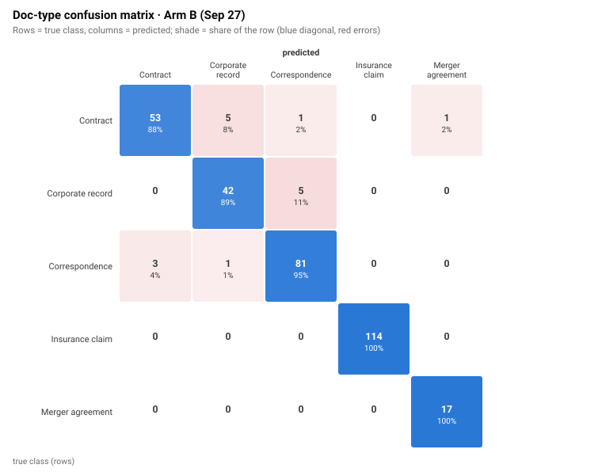
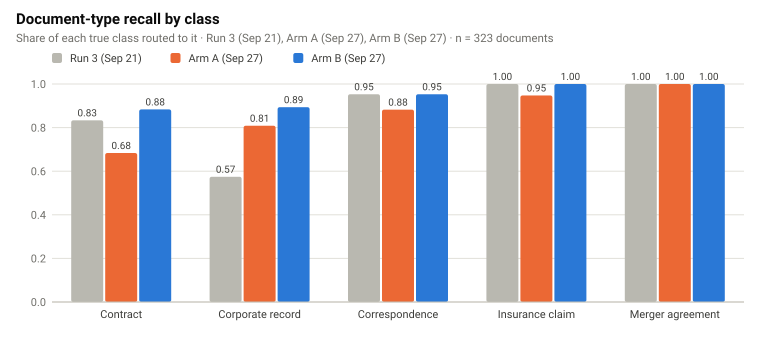
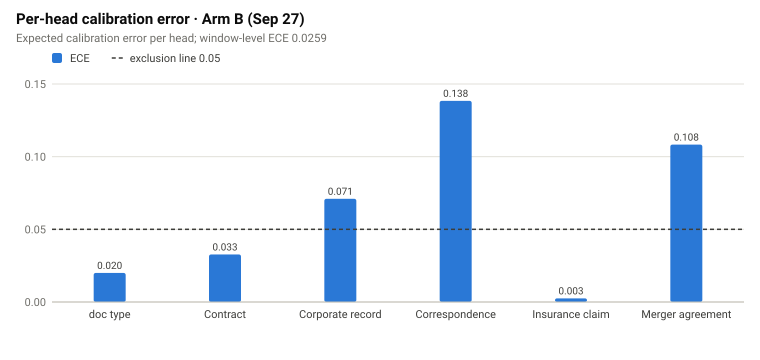
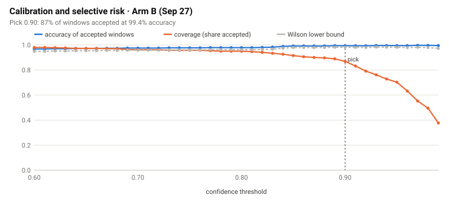
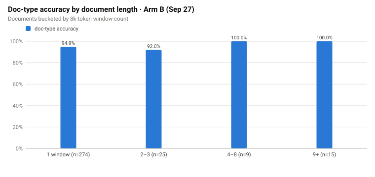
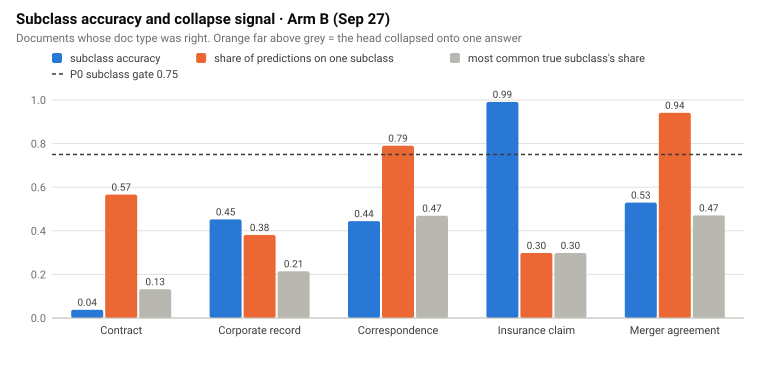

::: {.page}

[← Case study](../mailroom-ml.qmd){.back}

::: {.project-nav}
[Case study](../mailroom-ml.qmd) [Technical report](report.qmd){aria-current="page"} [Code](https://github.com/LLM-Mailroom-Services/mailroom-ml)
:::

# Mailroom-ML: technical report {.page-title}

[ModernBERT ingest classifier · training, calibration, routing]{.kicker}

## Summary

Mailroom-ML trains a hierarchical ModernBERT-base classifier for legal and insurance documents. It has one document-type head and one subclass head per type. Its job is to give a calibrated answer and a routing decision: either "this is safe to accept" or "send it to the LLM sorter".

On the final run, scored on the 323-document test split (541 windows), document-type accuracy is 0.9505 and window ECE is 0.0152. Under the routing gate, 74.3% of documents take the fast path, meaning they are handled without an LLM call. The fast-path and coverage numbers are optimistic, because the sweep that supports the 0.97 routing cutoff and the decode sweep both ran on this same split (see Routing and selective risk). Three of four acceptance gates are met. Contract subclass F1 is 0.162 against a floor of 0.20, so the subclass heads are not ready to act without the LLM.

Numbers on this page labelled "test split" come from those 323 documents. The split was kept out of training, out of checkpoint selection (done on validation) and out of calibration fitting. It is not untouched, though. I used it to compare runs, to run the selective-risk sweep that supports the 0.97 cutoff, and to run the decode sweep. The 0.97 value itself is a preset in the project's config, and the sweep recommended the same value. I name the project's runs as follows: Run 3 is an early two-epoch run, Arm A and Arm B are two comparison runs (a one-epoch smoke run and a three-epoch run), and M9b is the final four-epoch run. The six figures are from Arm B, not from the final run. Where the two differ I say so.

## System and data

### Stages and modules

| Stage | What it does | Module |
| --- | --- | --- |
| Configuration | One file holds the pinned data revisions, taxonomy, window sizes and routing thresholds that every other module imports | `src/mailroom_ml/config.py` |
| Normalisation | A deterministic text clerk that runs before training and before inference, so the two see the same bytes | `src/mailroom_ml/normalize.py` |
| Windowing | Token-level windows of 8,192 tokens with 512 tokens of overlap, plurality vote across windows | `src/mailroom_ml/windows.py` |
| Dataset build | Stages the training set, splits it, and runs the leak audits | `src/mailroom_ml/dataset.py` |
| Provenance | sha256 helpers and a byte-deterministic build manifest | `src/mailroom_ml/provenance.py` |
| Training | PyTorch training with checkpoint selection on validation | `training/train/train_modernbert.py` |
| Calibration | Per-head temperature scaling, ECE, Wilson bounds, selective-risk sweep | `src/mailroom_ml/calibration.py` |
| Out-of-distribution | Energy probe on the document-type logits, fit on validation | `src/mailroom_ml/ood.py` |
| Routing | Fast-path gate over calibrated confidence, agreement and margin | `src/mailroom_ml/routing.py` |
| Evaluation | Test-split scoring, cohorts, selective risk, paired bootstrap comparison | `training/eval/eval_modernbert.py`, `training/eval/compare_runs.py` |
| Deployment | ONNX export, parity check, Modal train and serve apps | `deploy/onnx_export.py`, `deploy/onnx_parity_check.py`, `deploy/modal_app.py`, `deploy/serve_app.py` |

### Data

The corpus has 3,302 documents in 55 document-type by subclass strata. The test split holds 323 of them, and the other 2,979 are split 90/10 into train and validation (2,680 and 299 documents; 5,068 windows in total). Splits are stratified by document type with a fixed seed. There are five trained document types: contract, merger agreement, corporate record, correspondence and insurance claim. A sixth label, `unknown`, exists only at inference as an abstention. The corpus was built from public sources; [the Digital-Mailroom case study](../digital-mailroom.qmd) describes how.

The test split contains 60 contracts, 47 corporate records, 85 pieces of correspondence, 114 insurance claims and 17 merger agreements. Several subclass cells have only a handful of examples, which limits what the subclass numbers can show.

### Data lineage

Every source in the build is pinned to an exact revision, never a floating tip. The build manifest records the source revision, split rule, label-normalisation rules, and leak-audit counts. It contains no timestamps, so rebuilding from the same inputs gives the same bytes, and the publish step checks each file's sha256 against what was uploaded. A test module covers the provenance code.

## Iteration history

::: {.timeline}
- **Run 3** — Two epochs, class weights, leak-fixed and clerk-normalised data. *Test-split document-type accuracy 0.8947, window ECE 0.0203. Contract and correspondence heads close to useless.*
- **Arm A** — One epoch with document-type loss weight 0.50, a short smoke run. *Accuracy 0.8638; under-trained.*
- **Arm B** — Three epochs, document-type loss weight 0.65. *Accuracy 0.9505, window ECE 0.0259, subclass accuracy given a correct type 0.5831. Chosen as the candidate release.*
- **Final run (M9b)** — Four epochs, same loss weight, logit-adjusted subclass loss with no class weights. *Accuracy 0.9505, ECE 0.0152, subclass accuracy 0.6287, fast-path rate 0.743 (up from 0.303). Contract F1 rose from 0.020 to 0.162; merger agreement fell from 0.238 to 0.000.*
- **Decode sweep** — Four values of a decode-time prior adjustment on the finished checkpoint. *Best contract F1 0.170. No setting reached 0.20, so no retrain on that recipe. The adjustment did lift the other heads: merger-agreement F1 rose from 0 to about 0.16 and correspondence F1 from 0.351 to between 0.41 and 0.44.*
:::

The early lesson came before Run 3. An earlier build used the filename as a fallback title. In that data, 42.8% of filenames carried the subclass name, and the insurance subclass F1 was a suspicious 1.0. I removed the fallback, republished the training set, and added a check to the build that fails if a filename-shaped title comes back.

## Results

### Final run, test split (323 documents, 541 windows)

| Measure | Value |
| --- | --- |
| Document-type accuracy | 0.9505 (307 of 323) |
| Subclass accuracy, document type correct | 0.6287 (193 of 307) |
| Window ECE, document type, calibrated | 0.0152 |
| Window ECE, banded | 0.0682 |
| Fast-path rate (documents) | 0.743 (240 of 323) |
| Out-of-distribution flag rate | 0.0402 (13 of 323) |
| Single-window documents (274) accuracy | 0.9489 |
| Multi-window documents (49) accuracy | 0.9592 |
| Scoring latency, L4 GPU, PyTorch | 0.575 s per document |

### Run comparison, test split

| Run | Epochs | Doc-type acc. | Subclass acc. (type correct) | Window ECE |
| --- | ---: | ---: | ---: | ---: |
| Run 3 | 2 | 0.8947 | 0.526 | 0.0203 |
| Arm A | 1 | 0.8638 | 0.4839 | — |
| Arm B | 3 | 0.9505 | 0.5831 | 0.0259 |
| Final (M9b) | 4 | 0.9505 | 0.6287 | 0.0152 |

On the 323 paired documents, the paired bootstrap gives a document-type difference of exactly 0.0000 between the final run and Arm B (all differences on this page are final minus Arm B), so the accuracy did not change. What changed is calibration and how many documents clear the gate. The fast-path rate rose by 0.44 (0.743 against 0.303), with a 95% interval of 0.38 to 0.50, which excludes zero. The comparison tool prints the opposite order, Arm B minus final, so its interval reads -0.50 to -0.38.

### Per-head macro-F1, test split

| Head | Arm B | Final |
| --- | ---: | ---: |
| contract | 0.0195 | 0.162 |
| corporate_record | 0.2485 | 0.904 |
| correspondence | 0.1289 | 0.351 |
| insurance_claim | 0.9889 | 1.000 |
| merger_agreement | 0.2381 | 0.000 |

The insurance score is high because that class is templated and has only six subclasses. Given the earlier leak, I treat a 1.000 as a prompt to keep looking, not as evidence of general skill. At the default decode, the merger-agreement result is a collapse: all 17 test merger agreements were assigned to one rare subclass that had 13 training windows, against 450 for the largest. Contract errors are different. The model spreads its answers over many subclasses and gets 14 of 53 right where the type was right, and services and supply contracts, with real support in training, are never recovered.

### Acceptance gates, test split

| Gate | Result | Threshold | Status |
| --- | ---: | ---: | --- |
| Document-type accuracy | 0.9505 | at least 0.89 | met |
| Window ECE | 0.0152 | at most 0.05 | met |
| Correspondence macro-F1 | 0.351 | at least 0.25 | met |
| Contract macro-F1 | 0.162 | at least 0.20 | not met |

### Routing and selective risk

The selective-risk sweep looks for the lowest confidence cutoff whose accepted set has a Wilson error bound within a 2% budget and a band calibration error under 0.05, with at least 30 observations. Lower cutoffs (0.87 to 0.96) met the error budget but failed the calibration check. On the final run it picks 0.97, accepts about 80% of windows (431 of 541) and reports a Wilson upper bound of 0.013 on the window error (1 miss in 431). That is a window-level figure. At the document level, I counted the per-document rows in the evaluation file: of the 240 documents on the fast path, none had the wrong document type, and 82 had the wrong subclass. Subclass labels on the fast path are therefore not reliable, and I treat the fast path as a document-type decision only.

::: {.caveat}
**Heads up.** That sweep ran over the test-split windows themselves, and so did the decode sweep. The gate's 0.97 confidence cutoff is a preset in the config (inherited from an earlier pipeline's confidence bands), and the sweep landed on the same value. So the sweep describes the operating point; it is not an independent validation of the cutoff, and the 74.3% fast-path rate and the 0.013 error bound are optimistic. The evaluation tool refuses to write routing thresholds from any pool containing test documents, so shipped thresholds are fit on the validation split.
:::

### Serving

I tested the ONNX path on the earlier Run 3 checkpoint, on an Apple M2 CPU. The fp32 export matched PyTorch within 4.25e-06 per head, against a gate of 1e-4. The int8 variant agreed on only 0.8, 0.2 and 0.6 of predictions for three heads, so I rejected it as the default and serve fp32. CPU p50 latency in fp32 was 75 ms at 64 tokens, 308 ms at 256 tokens and 1.63 s at 1,024 tokens. A bug I found in that work: the bundled tokenizer padded every window to 8,192 tokens and silently truncated longer documents. The loader now disables both. Warm latency for a short document dropped to about 0.03 s. I did not export ONNX for the final run, so these timings describe the earlier checkpoint.

### Cost

Training cost on Modal was estimated at about $6.0 for three epochs and $7.79 for four. A scoring pass over the 323 test documents on an L4 cost about $0.04.

## Figures

All six figures come from the earlier 3-epoch Arm B run. Its document-type accuracy matches the final run, but its calibration and fast-path numbers do not.

{.fig fig-alt="Confusion matrix for the 323 test-split documents. Insurance claims and merger agreements are all correct. Contracts 88% correct, mostly misrouted to corporate record. Corporate records 89% correct. Correspondence 95% correct." width="100%"}

{.fig fig-alt="Grouped bars of recall per document type for three runs. Contract recall is 0.83, 0.68 and 0.88; corporate record 0.57, 0.81 and 0.89; correspondence 0.95, 0.88 and 0.95; insurance claim and merger agreement near 1.0 throughout." width="100%"}

{.fig fig-alt="Bar chart of expected calibration error per head with a line at 0.05. Document type 0.020, contract 0.033, corporate record 0.071, insurance claim 0.003, merger agreement 0.108 and correspondence 0.138; correspondence, corporate record and merger agreement sit above the line." width="100%"}

{.fig fig-alt="Line chart over confidence thresholds from 0.60 to 0.90 showing accuracy of accepted windows rising and coverage falling, with a Wilson lower bound. The pick at 0.90 accepts 87% of windows at 99.4% accuracy." width="100%"}

{.fig fig-alt="Bar chart of document-type accuracy by window count: 94.9% for single-window documents (274), 92.0% for 2 to 3 windows (25), 100% for 4 to 8 (9) and 100% for 9 or more (15)." width="100%"}

{.fig fig-alt="Bar chart per document type with subclass accuracy and the share of predictions on one subclass, plus a 0.75 gate line. Contract subclass accuracy is 0.04 and corporate record 0.45; insurance claim is 0.99." width="100%"}

## Reproducibility

The project uses `uv` with a lockfile, and the pins live in `pyproject.toml` and `uv.lock`. The core test suite needs neither torch, onnxruntime nor Modal.

```sh
git clone https://github.com/LLM-Mailroom-Services/mailroom-ml.git
cd mailroom-ml
uv sync --extra dev
uv run pytest -m "not fullcorpus"
uv run ruff check src tests training deploy
```

Training and evaluation commands, from the README. The training command is the README's example, which uses three epochs. It is not the command of the final run, whose exact command I could not find recorded. The final run (M9b) trained for four epochs with no class weights, a separate learning rate for the subclass heads and a logit-adjusted subclass loss; the repository's `training/run_m9a_local.sh --arm=m9b` sets `--weight-mode none --subclass-head-lr 1e-3 --subclass-logit-adjust 1.0` for these.

```sh
uv sync --extra train
uv run python training/train/train_modernbert.py \
  --epochs 3 --select-on-subclass \
  --label-smoothing 0.05 --subclass-label-smoothing 0.0 \
  --input-construction v1
uv run python training/eval/eval_modernbert.py \
  --checkpoint artifacts/pytorch/model --sample 0 --json --selective-risk
uv run python training/eval/compare_runs.py --a <run_a.json> --b <run_b.json>
```

Seeds and pins: every split and shuffle uses seed 42; the final run's recorded settings were 4 epochs, batch 4 with 8 gradient-accumulation steps, learning rate 2e-5, subclass head learning rate 1e-3, label smoothing 0.05, and maximum length 8,192. The paired bootstrap uses 2,000 resamples at seed 42. Data sources are pinned to revisions in `src/mailroom_ml/config.py`. Cloud training needs a Hugging Face token and a Modal account and is gated on an explicit budget flag.

## Engineering quality

- 485 test functions in 33 test files, plus a shared `conftest.py`, covering calibration, windowing, routing, provenance, OOD, dataset build, evaluation CLI, training and deployment code.
- CI on pushes to `main` and on pull requests: `ruff` and `pytest -m "not fullcorpus"`, with strict markers.
- Deploy-layer tests skip themselves when heavy extras are missing and never touch the network.
- Failure behaviour is explicit: if the model is missing, fails to load, or has a label mismatch, the document goes to the LLM path instead of getting a guess. Flagged out-of-distribution documents fail the fast path, and so do catch-all `other` predictions and subclasses with fewer than 5 training rows.
- A non-smoke Modal run exports ONNX and runs the parity check, and promotes the checkpoint only if both pass.

## Limitations and next steps

- The test split is small. With 323 documents, and single digits in many subclass cells, subclass F1 is noisy.
- The gate cutoff (0.97) is a config preset that the sweep over the test windows then agreed with, so it needs an independent check on fresh data.
- Contract and merger-agreement subclass heads are not fit for acting alone. Contract families such as services and supply are never recovered, and the merger head collapses onto a rare class.
- Insurance claims come largely from synthetic or rendered sources and are very regular. Real claims will be messier.
- The ONNX timings are from an earlier checkpoint on a laptop CPU. The final run was not re-exported.
- The next step is more training data for the contract families that fail, then one training run with a gentler prior correction. More epochs on the current recipe will not help, because validation contract F1 had already flattened.
- [Mailroom Reloaded](../mailroom-reloaded.qmd) uses this model as its `bert_primary` stage, which will show how the gate behaves inside a full pipeline.

:::
