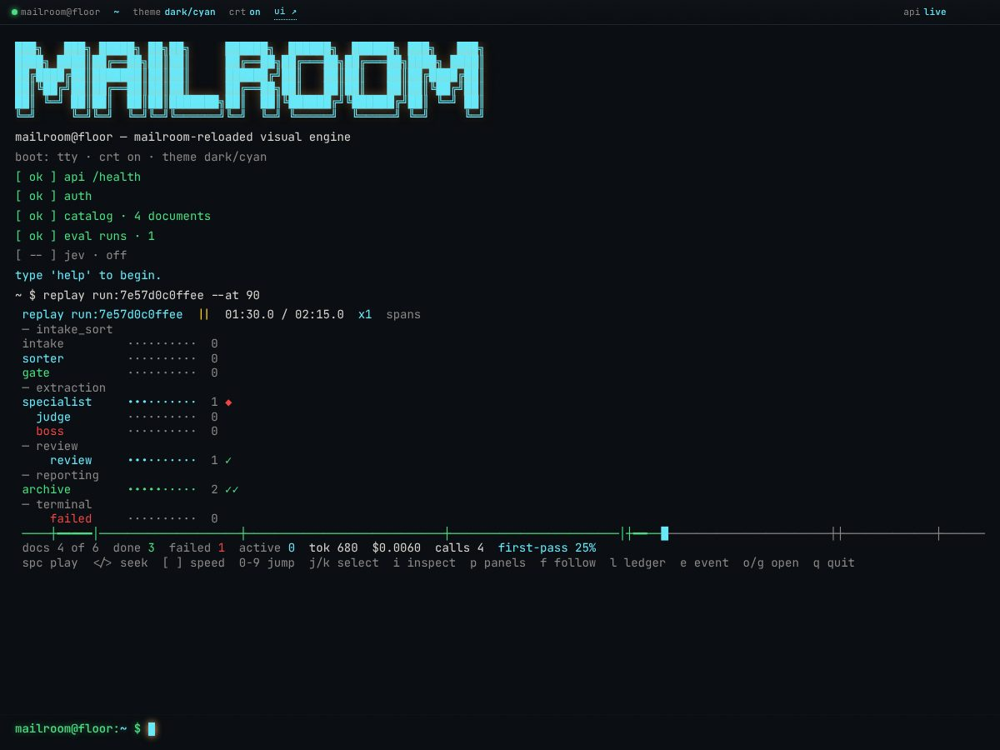
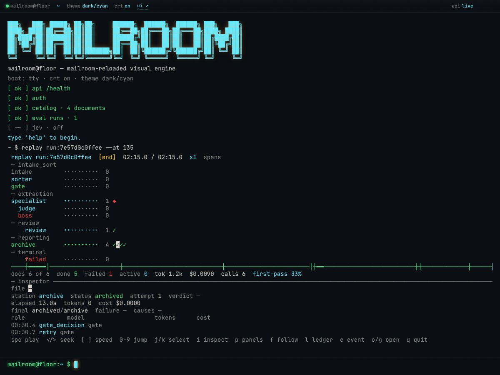
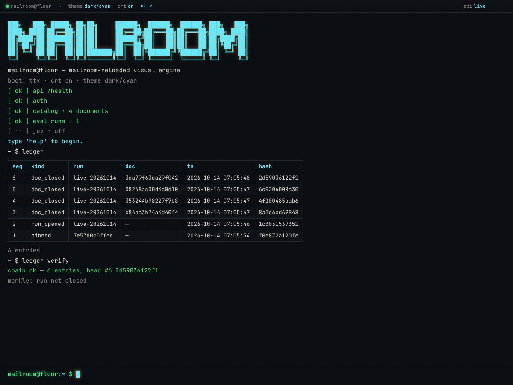

::: {.page}

[← All projects](index.qmd){.back}

::: {.project-nav}
[Case study](mailroom-reloaded.qmd){aria-current="page"} [Technical report](mailroom-reloaded/report.qmd) [Appendix](mailroom-reloaded/appendix.qmd) [Code](https://github.com/Exios66/mailroom-reloaded)
:::

# Mailroom Reloaded {.page-title}

[Agentic document pipeline · deployable rebuild]{.kicker}

## At a glance

::: {.stats}
::: {.stat}
[2]{.stat-value} [LLM calls for a clean text-layer document (sort, then extract)]{.stat-label}
:::
::: {.stat}
[1,288]{.stat-value} [`def test_` functions in 89 files on main 0e1dbd0. The 11 October run of 1,597 passed was not repeated]{.stat-label}
:::
:::

## The problem

My Digital Mailroom design routes incoming documents: decide what each one is, pull out the fields that matter, and file it with a record of what happened. Agent frameworks make that easy to prototype and hard to run. If the model decides what happens next, you cannot say in advance how many calls a document will cost, where a crash will leave it, or why it ended up in a given folder.

Mailroom Reloaded is a rebuild of that design as a single deployable service, built around one rule: code owns the control flow, and models are called at fixed points.

## Approach



The pipeline is a CrewAI Flow, but a deterministic driver walks it, not CrewAI's event engine. A clean text document goes through local ingest, the ModernBERT fast path from [Mailroom-ML](mailroom-ml.qmd), one sorter call, a gate, one specialist extraction call, a second gate, and then report, catalog and archive. The gates are plain threshold code with zero LLM calls. That is why the cost of a clean document is exactly two calls.

When a gate is not satisfied, fixed rules pick the next step, and the two gates have different branches:

- **Classify gate:** re-sort once, as a full pass, if the fast path and the sorter disagree about the class; retry a low-confidence sort, up to a configured limit; after the retries, park the document for human review.
- **Extract gate:** send a middling-confidence result to verification, where a judge grades the extraction and an arbiter decides whether to accept, re-extract or escalate; retry a low-confidence extraction, up to the limit; after the retries, escalate to a boss agent that can reassign the class or send the document to human review. An extraction that is invalid or cut off by the length limit is retried, then parked for human review.

The ModernBERT fast path runs first and fails open. If the package or model is missing, the input is oversized, or anything errors, the pipeline falls back to a full LLM sort instead of stopping.

## What I built

- **Durability.** Documents move between bin folders (inbox, processing, review, failed, archive) by atomic rename, with a JSON manifest per document. Every completed node is checkpointed, so a crashed watcher resumes from the last finished node. A SQLite catalog and a hash-chained audit log record what happened; a second chain covers every run, with optional off-host anchoring.
- **Observability.** OpenTelemetry traces go to Phoenix, metrics to Prometheus, and provisioned Grafana dashboards (Pipeline, Serving & GPU, Quality) sit on top. Spans carry metadata, not document text.
- **Two consoles.** `/ui` is a plain JavaScript runs page. `/tui` is a browser terminal with a replay viewer that scrubs through a recorded run station by station, shows retries and escalations, and verifies the ledger chain.
- **Deployment.** One Docker Compose file with profiles for a local llamafile sidecar, a local vLLM server with GPU metrics, and a split watcher. Providers are switchable: a mock for tests, OpenRouter, vLLM, or llamafile. Gmail intake is an optional extra.
- **An opt-in decision model.** "Jev" is a calibrated, probabilistic decision model, not a chat model: it answers typed questions (a choice, a yes-probability, a score). When enabled and calibrated, it may overrule the gate only inside the medium-confidence band, never a hard rule. It is off by default and the pipeline is unchanged without it.
- **An evaluation harness.** `mailroom eval` samples a pinned dataset revision with a fixed seed, keeps ground truth away from the pipeline, and fits any learned gate on the training split only.

## Results

I have no accuracy or cost numbers to publish for this service yet. The harness exists and is tested, but I have not committed evaluation results, so I am not quoting any. What I can show is that the machinery runs end to end: the main-branch verification ran four seeded documents through the stack with a mock provider and all four archived, and eleven browser checks of the replay viewer passed.

{.fig fig-alt="A dark terminal-style page with a large cyan MAILROOM banner and the status bar showing theme dark/cyan. The command replay run:7e57d0c0ffee --at 90 is running, paused at 01:30.0 of 02:15.0. Station rows are grouped under intake_sort, extraction, review, reporting and terminal, each with a dotted progress bar and a count. Sorter, specialist, judge and review are cyan, gate and archive are green, boss and failed are red, intake is grey, and a red marker sits on specialist. A scrub bar and a line reading docs 4 of 6, done 3, failed 1, tok 680, $0.0060, calls 4, first-pass 25% sit below, followed by a row of key hints." width="100%"}

{.fig fig-alt="The same cyan terminal page at the end of the run, 02:15.0 of 02:15.0, with an inspector panel open under the station grid and metrics line. It shows the document's station archive, status archived and attempt 1, then an event table with two rows: 00:30.4 gate_decision gate and 00:30.7 retry gate, with cyan event names." width="100%"}

{.fig fig-alt="A cyan terminal page with a table with columns seq, kind, run, doc, ts and hash, with cyan column headings. Rows are one pinned entry, one run_opened entry and four doc_closed entries. Below the table, the text 6 entries, then the command ledger verify, then a green line reading chain ok, 6 entries, head #6, and a grey line reading merkle: run not closed." width="100%"}

::: {.caveat}
**Heads up.** The screenshots come from a demo run on a mock LLM provider with seeded documents, so the counts and costs in them describe the demo, not model quality.
:::

## What I learned

- Fixing the number of model calls at design time made everything else easier to reason about: cost, resume points, and what to log.
- Fail-open fast paths need to be tested as hard as the fast path itself.
- A hash chain on one disk detects edits, reordering and middle deletions, but not truncation of the tail. The docs say so, and the optional anchor exists for that reason.
- A replay viewer paid for itself quickly. Seeing a retry on a timeline beat reading logs.

## Stack

[Python]{.tag} [CrewAI Flows]{.tag} [FastAPI]{.tag} [SQLite]{.tag} [ModernBERT]{.tag} [OpenTelemetry]{.tag} [Phoenix]{.tag} [Prometheus]{.tag} [Grafana]{.tag} [Docker Compose]{.tag} [vLLM]{.tag} [pytest]{.tag}

:::
