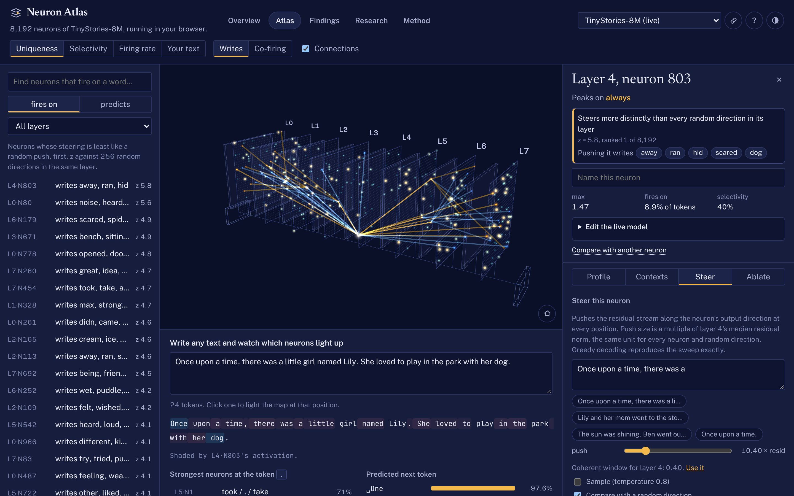

::: {.page}

[← All projects](index.qmd){.back}

::: {.project-nav}
[Case study](neuron-atlas.qmd){aria-current="page"} [Code](https://github.com/Exios66/LLM_Viz) [Live demo](https://exios66.github.io/LLM_Viz/)
:::

# Neuron Atlas {.page-title}

[Mechanistic interpretability · interactive visualization & evaluation]{.kicker}

Push one neuron and watch the story change. Neuron Atlas maps a small language model's feed-forward neurons, lets you intervene in its computation, and compares the effect with random pushes of the same size. The goal is not just an interesting picture: it is a finding someone else can inspect and replay.

::: {.actions}
[Open Neuron Atlas](https://exios66.github.io/LLM_Viz/){.btn .primary} [View the code](https://github.com/Exios66/LLM_Viz){.btn}
:::

::: {.stats}
::: {.stat}
[8,192]{.stat-value} [TinyStories-8M neurons swept: 8 layers × 1,024 MLP neurons]{.stat-label}
:::
::: {.stat}
[2,048]{.stat-value} [random-direction controls: 256 in each layer]{.stat-label}
:::
::: {.stat}
[41]{.stat-value} [neurons beat every control in their layer on the original theme score]{.stat-label}
:::
:::

## The problem

A striking continuation is easy to overinterpret. A neuron might appear to write a villain or a moral, but a random direction can write one too. I wanted to make that comparison visible, and to separate what a neuron responds to from what happens when its output is pushed.

The steering-first method builds on [neuron-explorer](https://github.com/lyramakesmusic/neuron-explorer). My implementation brings it to a small model that runs in the browser, then extends the analysis with control comparisons, held-out prompts and recorded studies of larger models.

## What I built

- **A live model runtime.** A GPT-Neo forward pass in TypeScript, with a KV cache and hooks for ablation, scaling, clamping and steering. TinyStories-8M inference runs in a Web Worker; using the site needs no inference server or GPU.
- **A 3D atlas.** React and Three.js display the neurons by output direction or co-firing. An inspector shows activation contexts, measured steering effects and the logit lens. Search, keyboard navigation and deep links make a particular neuron shareable.
- **An offline measurement pipeline.** Python builds the atlas, calibrates push strengths by layer, sweeps every TinyStories neuron and scores the text against matched random-direction controls. The browser replays recorded examples with the same prompt and push.
- **Recorded model studies.** Qwen3.5-0.8B (86,016 neurons) and a Qwen2.5-0.5B bad-medical-advice fine-tune (116,736 neurons) can be explored as recorded data. These models do not run live in the browser.
- **Verification and failure handling.** The repository checks the TypeScript runtime against PyTorch and includes browser tests for navigation, replay, accessibility, phone layouts, blocked storage and failed downloads. These are upstream checks, not a claim that I reran their full suite for this portfolio page.

{.fig fig-alt="Neuron Atlas in a dark theme: a Three.js map of stacked model layers beside the inspector for layer 4 neuron 803. Its steering tab has a story prompt, a push-strength slider and random-direction controls. The inspector ranks this neuron first of 8,192 on the recorded theme score." width="100%"}

## What the controls changed

The original sweep's naive repeated-word test found a theme in 75% of neurons and 78% of random directions. Only 41 of 8,192 neurons (about 0.5%) outscored every control in their own layer. A compelling story alone is not evidence of a distinctive neuron.

For example, [L4 N803, “Run and hide”](https://exios66.github.io/LLM_Viz/#/findings/run-and-hide), changes a sunny scene into a threat followed by flight. That is a useful description of the recorded text, not proof that the neuron represents a single human concept. The later robustness study reports that 21 of the original 41 still beat 95% of fresh random directions on 12 unseen prompts with sampling.

## Limits and reproducibility

::: {.caveat}
**A small-model study, not a safety guarantee.** These are interventions on particular models, prompts and scoring rules. Beating a finite set of controls is not a corrected significance test, a general explanation of a neuron, or evidence that a system is safe. TinyStories live inference and the larger models' offline recordings are different capabilities.
:::

The upstream runtime verification reports exact replay of all 16 curated neuron cards, but only 47 of 48 sampled sweep rollouts: near-tied float32 logits can change greedy decoding. The model, corpus and code also have separate license terms.

This page was reviewed on **6 November 2026**, against [source revision a580008](https://github.com/Exios66/LLM_Viz/tree/a58000861b424280158cea728cf7b29edaf385d1). The project linked in issue #89 began on the [neuron-atlas branch](https://github.com/Exios66/LLM_Viz/tree/neuron-atlas); the published project now includes the recorded-model studies too. The [research reports](https://github.com/Exios66/LLM_Viz/tree/a58000861b424280158cea728cf7b29edaf385d1/docs/research) and the live site's [Method page](https://exios66.github.io/LLM_Viz/#/method) contain the methods, findings and limitations.

## What I learned

- Put a null comparison next to the attractive example, not in a footnote.
- Separate what a neuron reads, what its output writes, and whether removing it matters.
- Treat a replayable measurement and its limits as part of the interface.

## Stack

[TypeScript]{.tag} [React]{.tag} [Three.js]{.tag} [Web Workers]{.tag} [Python]{.tag} [PyTorch]{.tag} [Playwright]{.tag}

:::
