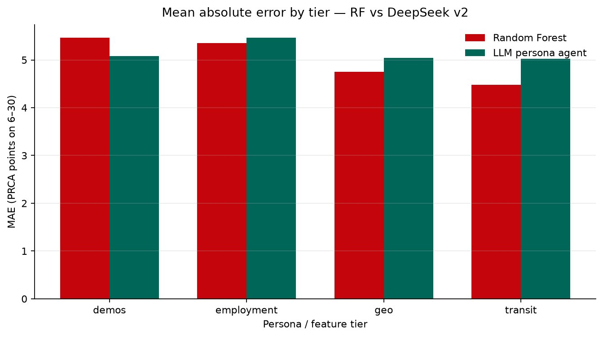
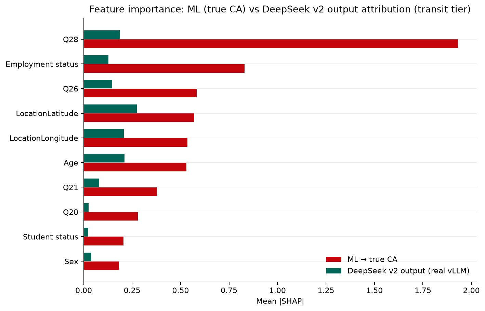

::: {.page}

[← All projects](index.qmd){.back}

::: {.project-nav}
[Case study](psychometric-digital-twin.qmd){aria-current="page"} [Technical report](psychometric-digital-twin/report.qmd) [Code](https://github.com/Exios66/psych755-jjb)
:::

# Psychometric Digital Twin {.page-title}

[Behavioral ML research · UW–Madison]{.kicker}

Final project for PSYCH 755 at UW–Madison, taught by Dr. Adam Ross Nelson (Summer 2026).

## At a glance

::: {.stats}
::: {.stat}
[241]{.stat-value} [survey respondents analysed, from 252 matched Prolific and Qualtrics records]{.stat-label}
:::
::: {.stat}
[5.02 vs 4.49]{.stat-value} [group-score error in points on the 6–30 scale: best LLM persona (pooled over tiers) vs best classical model (at the transit tier)]{.stat-label}
:::
::: {.stat}
[0.53 vs 0.72]{.stat-value} [AUC for telling low from high group apprehension at the transit tier: best persona run vs random forest]{.stat-label}
:::
:::

In short, the LLM personas did not beat simple models. Most were worse than guessing the average respondent.

## The problem

Researchers now use LLMs as stand-ins for survey respondents. The idea is to describe a person in a prompt and ask the model to answer as that person. I wanted to test that idea on one validated scale, where the real answer is known.

The scale is the PRCA-24, a self-report measure of communication apprehension (CA). I used its group-discussion and interpersonal subscales, each scored 6 to 30. The question: when the model is told who a respondent is in the second person ("You are a ..."), how close does it get to that respondent's own scores? And when it is wrong, does the error follow demographic group, which would look like stereotyping?

## Approach



The survey was collected through Prolific and Qualtrics for the course. After matching and dropping respondents with incomplete scale items, 241 were left. For each one I built prompts in cumulative tiers: demographics, then employment, then survey location, then transit and ride-share habits, then (for the LLMs only) two open-text answers.

I ran open-weight models on a GPU with vLLM: Llama 3.1 8B Instruct, Llama 3.2 3B Instruct, DeepSeek-R1-Distill-Llama-8B and Llama 3.3 70B Instruct (AWQ). The Llama 3.2 3B base model could not follow the output format and is left out of the scores. I compared them with seven classical models on the same tiers: Ridge, Elastic Net, k-NN, random forest, histogram gradient boosting, XGBoost and a small neural net, all with 5-fold cross-validation.

## What I built

- **A cleaning and scoring pipeline.** It joins the two survey exports, scores the scale and checks every tier against the same targets.
- **Tiered persona prompts and batch inference.** Three prompt versions, from five to eight tiers, run on a GPU host.
- **A shared evaluation.** Error in points, exact match, low/moderate/high band accuracy, F1 and AUC, computed the same way for LLMs and classical models.
- **Explanation and bias checks.** SHAP on the models and on a surrogate fit to the LLM's outputs, plus error by employment, sex, student status and age.
- **Secondary studies on public-transit use.** These use random forests only, with no LLM.

## Results

The classical floor is low but not far below a constant guess. Ridge reaches 4.49 points of group error at the transit tier. The pooled LLM errors run from 5.02 (DeepSeek, second prompt version) to 6.02 (Llama 3.3 70B). By my own calculation from the cohort table, always predicting the cohort mean gives 4.93, so the LLM personas did not beat that.

{.fig fig-alt="Grouped bar chart of mean absolute error in score points, averaged across both subscales, for four tiers: demos, employment, geo and transit. The random forest falls from about 5.5 at demos to about 4.5 at transit. The LLM persona agent stays near 5.0 to 5.5 across all four tiers and is higher than the forest at every tier except demos." width="100%"}

More context helped the classical models and did not help the LLM. The random forest improved at each added tier. DeepSeek's error stayed flat and got slightly worse at the employment step. At the transit tier the forest separated low from high apprehension with an AUC of 0.72 on the group score. DeepSeek scored 0.53, close to chance, and never predicted the high band for group CA.

The feature results explain part of it. In the forest, ride-share days (Q28) was the strongest feature by far. In a surrogate model fit to the LLM's outputs, latitude and age came first.

{.fig fig-alt="Horizontal paired bars of mean absolute SHAP value for ten features. For the random forest predicting true scores, Q28 ride-share days is by far the longest bar at about 1.9, followed by employment status. For the LLM output surrogate, bars are much shorter, with latitude, age and longitude the longest at about 0.2 to 0.3." width="100%"}

On bias, the clearest pattern was employment. DeepSeek's group error was about 4.4 points for full-time respondents and about 5.5 to 6.2 for part-time and other. It under-predicted part-time and other respondents by roughly 1.7 to 3.6 points on average. Those groups did score higher on the scale, so the model missed a real difference rather than inventing one. Sex and student-status gaps were small. Group sizes are small too, so I treat all of this as descriptive.

::: {.caveat}
**Heads up.** This is one cohort of 241 online panel respondents. The classical models are cross-validated, but the LLM runs are single passes, and the constant-guess figure is computed on the same people it is scored on. The transit studies are associations, not causes.
:::

The technical report has the full tables, per-model results, the factor-analysis and secondary results, and the commands to reproduce them.

## What I learned

- A model that looks close on average error can still fail at the task. DeepSeek stayed near the mean, so its error was modest and its ranking of people was near chance.
- Report band accuracy and AUC next to error. Error alone hid the failure.
- Adding prompt detail is not a free gain. One bundle of transit text made Llama 3.1's interpersonal error jump from 4.67 to 8.17 points, and a rewritten prompt did not fix it.
- A simple baseline belongs in every LLM evaluation. Here a ridge model and even a constant guess set a bar the personas did not clear.

## Stack

[Python]{.tag} [scikit-learn]{.tag} [XGBoost]{.tag} [SHAP]{.tag} [Factor analysis]{.tag} [vLLM]{.tag} [Quarto]{.tag} [pytest]{.tag}

:::
