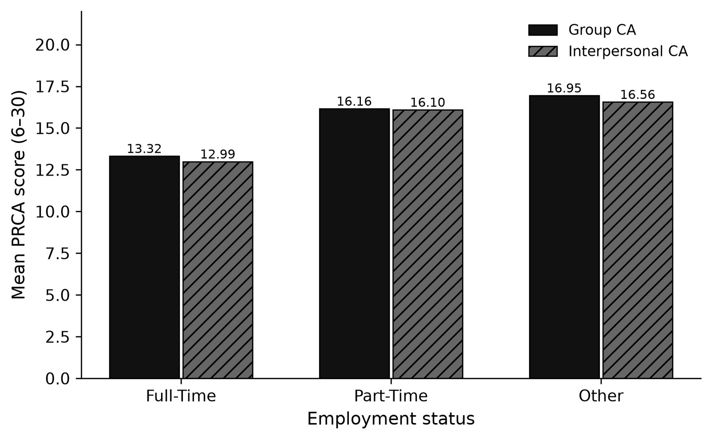
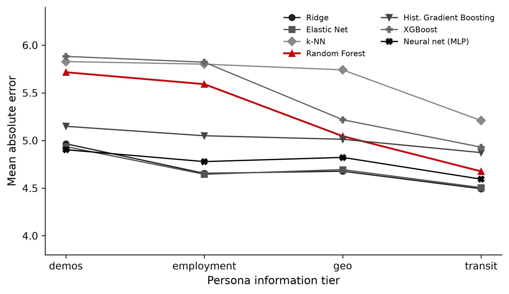
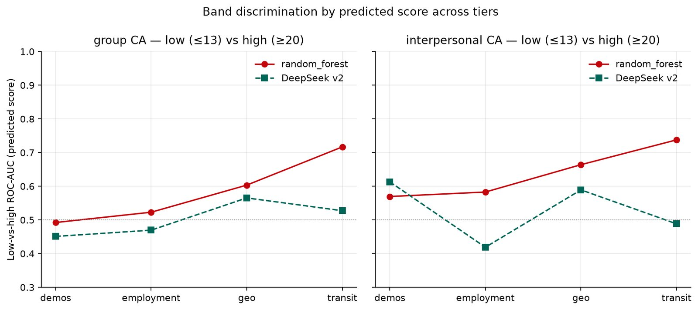

::: {.page}

[← Case study](../psychometric-digital-twin.qmd){.back}

::: {.project-nav}
[Case study](../psychometric-digital-twin.qmd) [Technical report](report.qmd){aria-current="page"} [Appendix](appendix.qmd) [Code](https://github.com/Exios66/psych755-jjb)
:::

# Psychometric Digital Twin: technical report {.page-title}

[Behavioral ML research · UW–Madison]{.kicker}

## Summary

This is the final project for PSYCH 755 at UW–Madison, taught by Dr. Adam Ross Nelson (Summer 2026). It asks whether an LLM, given a second-person prompt built from a survey respondent's attributes, can predict that respondent's own scores on two subscales of the PRCA-24 communication-apprehension measure, and whether its errors follow demographic group.

On 241 respondents, none of the open-weight models was a close match to the real scores. The best persona run (DeepSeek-R1-Distill-Llama-8B, second prompt version) had a pooled group-score error of 5.02 points on the 6–30 scale. Ridge regression reached 4.49 at the transit tier. By my own calculation, always predicting the cohort mean gives 4.93. At the transit tier the persona's scores also did not rank people: its low-versus-high AUC was 0.53 on the group score, against 0.72 for a random forest.

Everything on this page is an aggregate. The survey data are private and are not published.

## System and data

### Data

The survey was collected through Prolific and Qualtrics for the course. Two Prolific recruitment waves were stacked (262 unique participants) and joined to 273 Qualtrics rows by the participant identifier the respondents typed into the survey. That gave 252 matches. Eleven had incomplete PRCA items and were dropped, leaving an analytic sample of 241. Both subscales are the sum of six five-point items, with comfort items reverse-coded, so each runs from 6 to 30. The repository states no ethics or consent details, so I make no claim about them here.

| Measure | Group CA | Interpersonal CA |
| --- | --- | --- |
| Mean (SD) | 14.62 (6.03) | 14.31 (5.82) |
| Median | 13 | 13 |
| Low (13 or less) / moderate (14–19) / high (20 or more) | 53.9% / 25.3% / 20.7% | 53.1% / 28.6% / 18.3% |

Group means differ by employment. Full-time (n = 148) is 13.32, part-time (n = 31) is 16.16 and other (n = 62) is 16.95. Mean group CA also falls with public-transit use, from 17.38 for riders who never use transit (n = 50) to 12.84 for those riding eight or more days a month (n = 55).

{.fig fig-alt="Grouped bar chart of mean group and interpersonal PRCA scores for full-time, part-time and other employment. Full-time is lowest at 13.32 and 12.99. Part-time is 16.16 and 16.10. Other is highest at 16.95 and 16.56." width="100%"}

### Persona tiers



Each tier adds to the one before it.

| Tier | Adds |
| --- | --- |
| demos | Age, sex, country, student status |
| employment | Employment status |
| geo | Survey latitude and longitude |
| transit | Public-transit, ride-share, licence and car-access answers |
| full | Two open-text answers (LLM prompts only) |

Prompts are a second-person narrative ("You are a ...") with the request to report one's own scores as JSON. Version 1 used full-precision coordinates and a soft JSON request. Version 2 rounded coordinates to one decimal, skipped follow-up transit questions when the answer was "never", asked for the two subscales independently and used guided JSON. Version 3 added three single-cue tiers (ride-share only, public transit only, open text only). The classical models see the first four tiers only.

### Models and metrics

I ran Llama 3.1 8B Instruct, Llama 3.2 3B Instruct, DeepSeek-R1-Distill-Llama-8B and Llama 3.3 70B Instruct (AWQ) with vLLM. Version 1 used greedy decoding, a maximum of 256 new tokens and an 8,192-token context. Version 2 used temperature 0.3, seed 42 and guided JSON. Llama 3.2 3B base is left out of all scores, because it produced valid output for 7.1% of version 1 prompts and 0% of version 3. DeepSeek parsed 1,203 of 1,205 version 2 prompts.

The classical suite is Ridge, Elastic Net, k-NN (k = 3), random forest (200 trees), histogram gradient boosting, XGBoost and a small neural net, scored with shuffled 5-fold cross-validation at seed 42. Metrics are mean absolute error (MAE) in score points, exact-match rate, band accuracy and per-band F1 for the low, moderate and high bands, and AUC for low versus high.

## Results

### Classical baselines

Group-score MAE by model and tier, lower is better:

| Model | demos | employment | geo | transit |
| --- | --- | --- | --- | --- |
| Ridge | 4.97 | 4.66 | 4.68 | **4.49** |
| Elastic Net | 4.94 | **4.65** | 4.69 | 4.51 |
| Neural net | **4.90** | 4.78 | 4.82 | 4.59 |
| Random forest | 5.72 | 5.59 | 5.05 | 4.68 |
| Histogram gradient boosting | 5.15 | 5.05 | 5.01 | 4.87 |
| XGBoost | 5.81 | 5.90 | 5.26 | 4.99 |
| k-NN | 5.83 | 5.84 | 5.74 | 5.21 |

Linear models were the strongest floor. Boosting did not win, which fits a small sample with few features. The best transit-tier band accuracy for group CA was 0.481, and R-squared peaked at only about 0.13 to 0.15 at transit for the best models. The classical models explain a small share of individual differences. The interpersonal table is in the repository; its best transit MAE is 4.25 (Elastic Net).

{.fig fig-alt="Line chart of mean absolute error by tier for seven models. Ridge, Elastic Net and the neural net sit lowest, near 4.9 at demos and about 4.5 to 4.6 at transit. The random forest, highlighted, falls from about 5.7 to 4.7. k-NN is highest throughout, ending near 5.2." width="100%"}

A constant guess is a useful reference. From the committed cohort table I computed the MAE of always predicting the cohort mean, which is 4.93 for group CA and 4.63 for interpersonal CA, and of always predicting the median, 4.74 and 4.51. This is my own calculation and is in-sample, so it flatters the constant guess a little. It still shows the room above the floor is small.

### LLM personas

Pooled over the five tiers of version 1 (1,205 prompts per model):

| Model | Group MAE | Interpersonal MAE | Group band accuracy | Interpersonal band accuracy |
| --- | --- | --- | --- | --- |
| DeepSeek-R1-Distill-Llama-8B | 5.22 | 5.73 | 33.4% | 35.4% |
| Llama 3.2 3B Instruct | 5.51 | 5.35 | 52.7% | 30.0% |
| Llama 3.1 8B Instruct | 5.92 | 5.82 | 28.8% | 40.2% |
| Llama 3.3 70B Instruct | 6.02 | 4.65 | 26.3% | 52.0% |

Exact-match rates were 6.1% to 9.1% for group CA. The 70B model's good interpersonal numbers are a failure. By the project's count about 93% of its outputs were the same pair of scores, 18 and 12, so it is not tracking individuals. Llama 3.2 3B Instruct's 52.7% group band accuracy is close to the cohort's 53.9% share of low-band respondents. At the transit tier its band F1 was 0.68 for low, 0.11 for moderate and 0 for high, so it looks like a model that mostly says "low".

Version 2 improved DeepSeek (group 5.02, interpersonal 5.26) and made the others worse. Llama 3.1 went to 5.99 and 7.63, and Llama 3.2 3B Instruct to 5.73 and 6.07. Version 3, greedy and eight tiers, left Llama 3.1 at 5.99 and 5.76, Llama 3.2 3B Instruct at 5.72 and 6.81, and the 70B model at 6.01 and 4.61, again as a constant prior. The enhanced-decode rerun of version 3 is still pending in the repository.

### Per-tier results

Group-score MAE by tier, with the best classical value and the persona runs:

| Run | demos | employment | geo | transit |
| --- | --- | --- | --- | --- |
| Best classical | 4.90 | 4.65 | 4.68 | 4.49 |
| Random forest | 5.72 | 5.59 | 5.05 | 4.68 |
| DeepSeek, v2 | 5.05 | 5.15 | 4.89 | 4.97 |
| DeepSeek, v1 | 5.12 | 5.16 | 5.30 | 5.15 |
| Llama 3.2 3B Instruct, v1 | 5.59 | 5.59 | 5.63 | 5.47 |
| Llama 3.1 8B Instruct, v1 | 6.05 | 6.03 | 6.02 | 5.68 |
| Llama 3.3 70B Instruct, v1 | 6.05 | 6.07 | 6.07 | 6.08 |

{.fig fig-alt="Grouped bar chart of mean absolute error by tier. The random forest falls from about 5.5 at demos to about 4.5 at transit. The LLM persona agent stays between about 5.0 and 5.5 and is higher than the forest at employment, geo and transit." width="100%"}

The random forest improved at each step in the averaged view, from 5.47 at demos to 4.48 at transit. DeepSeek version 2 went 5.08, 5.47, 5.05 and 5.03, so employment was its worst tier. DeepSeek version 2 beats the random forest at demos, but not the best classical model. The open-text tier had mixed effects. It gave Llama 3.2 3B Instruct its best group MAE (5.29) and DeepSeek version 1 its best interpersonal MAE (5.42), while Llama 3.1's interpersonal error at that tier (6.92) stayed above its demos value.

One failure is large. Llama 3.1's interpersonal MAE rose from 4.67 at demos to 8.17 at transit, its band accuracy fell from 51.9% to 15.4%, and its mean signed error went from -2.21 to +6.52. It began predicting high apprehension for people whose transit answers were added. Version 2's rewrite did not remove it (transit 8.23). In the version 3 ablations the bundled transit tier gave 7.77, while public transit alone gave 4.85, open text alone 5.82 and ride-share alone 5.92. Only the combined bundle triggered it. I do not know why, and I did not test an explanation.

### Band discrimination

Error in points hid how poorly the personas ranked people. At the transit tier:

| Agent | Target | Band accuracy | Low-vs-high AUC |
| --- | --- | --- | --- |
| Random forest | Group | 0.481 | 0.717 |
| Random forest | Interpersonal | 0.531 | 0.738 |
| DeepSeek v2 | Group | 0.358 | 0.527 |
| DeepSeek v2 | Interpersonal | 0.363 | 0.488 |

DeepSeek version 2 made no group-CA predictions in the high band (0 of 240). The forest made 12, and only 25% of them were truly high. Both did best on the low band. DeepSeek's scores stayed close to the cohort mean, which keeps the MAE reasonable and leaves the ranking near chance.

{.fig fig-alt="Two line charts, for group and interpersonal CA, of low-versus-high ROC-AUC across four tiers. The random forest rises from about 0.5 at demos to about 0.72 and 0.74 at transit. DeepSeek version 2 stays between about 0.42 and 0.61, near the 0.5 chance line." width="100%"}

### Features

In a forest predicting true group CA at the transit tier, mean absolute SHAP values were highest for ride-share days (Q28, 1.93), then employment (0.83), public-transit days (0.58), latitude (0.57), longitude (0.54) and age (0.53). I also fit a surrogate forest to DeepSeek's outputs (R-squared 0.74). Its top features were latitude (0.27), age (0.21), longitude (0.21) and Q28 (0.19), with magnitudes about seven times smaller. The persona leaned on place and age, while the real signal was in ride-share use and employment. Permutation importance on the full cohort agrees that Q28 comes first (1.518), but ranks age second.

{.fig fig-alt="Paired horizontal bars of mean absolute SHAP value for ten features. For the forest predicting true scores, Q28 is longest at about 1.9, then employment status at about 0.8. For the surrogate of the LLM's outputs, all bars are short, with latitude, age and longitude longest at about 0.2 to 0.3." width="100%"}

Factor analysis of the scored PRCA items supports treating the group and interpersonal subscales as related but separable, so I report them separately. The repository describes this in words and gives no loadings table, so I report none.

### Bias by group

I sliced DeepSeek version 2's group-score error by group. These are descriptive MAE and signed-error gaps. I did not run formal association tests on the LLM exports.

| Group | n | MAE at demos | Mean signed error at demos | MAE at transit | Mean signed error at transit |
| --- | --- | --- | --- | --- | --- |
| Full-time | 148 | 4.37 | -0.01 | 4.39 | +0.43 |
| Part-time | 31 | 6.06 | -2.00 | 5.55 | -1.68 |
| Other employment | 62 | 6.16 | -3.58 | 6.07 | -3.61 |
| Female | 120 | 4.93 | -1.47 | 4.73 | -0.97 |
| Male | 121 | 5.17 | -0.90 | 5.20 | -0.77 |

Employment is the clear gap. Errors were about 1.2 to 1.8 points larger for part-time and other respondents, and the model under-predicted them. Those groups did score higher in the survey (16.16 and 16.95 against 13.32), so this is a calibration miss on real differences, and the model did not invent a stereotype. Sex gaps were under 0.5 points. Student-status slices were small (34 students) and noisy. Tier-by-tier values for the employment slices are in the repository's export tables. Different tiers moved them by up to about 1.6 points, so I would not read the second decimal.

### Secondary studies: regular public-transit use

These use no LLM. "Regular" means Q26 answers of four or more days a month, which is 101 regular and 140 non-regular respondents (41.9%). AUCs are from stratified 5-fold random forests at seed 42.

| Question | Result |
| --- | --- |
| Do regular riders differ in CA? | Group CA 13.04 against 15.76 (difference -2.72, d = -0.46, Welch p < .001, bootstrap 95% CI -4.15 to -1.28). Interpersonal 13.31 against 15.04 (difference -1.73, d = -0.30, p = .020, CI -3.12 to -0.25). |
| Does location predict regular use? | Latitude and longitude: AUC 0.551. Country alone: 0.549. Near chance. |
| Do CA scores predict it? | Group plus interpersonal: 0.590. Group only 0.555, interpersonal only 0.507. |
| Do Q27 and Q28? | Q28 (ride-share days) 0.762, Q27 (rides per day) 0.589, both together 0.761. |
| Follow-ups | Q28 after conditioning on car access (n = 149): 0.730. Age, sex and student status (n = 224): 0.618. Holding all transit questions out, demographics plus employment and location: 0.662, or 0.672 with CA. |

Ride-share use was the dominant signal, and CA added little once it was known. Riders had lower CA, but I cannot say which way any link runs. These are same-wave associations.

## Reproducibility

The repository exposes a `ca-personas` command-line tool. From the README:

```sh
pip install -r requirements.txt
pip install -e ".[dev]"
ca-personas prepare --join inner
ca-personas ml-baseline --join inner --seed 42
ca-personas compare --provider mock --join inner
ca-personas shap-eval --join inner --provider mock --shap-tier transit
ca-personas stereotype-eval --join inner --provider mock
ca-personas transit-ca --join inner
ca-personas geo-transit-rf --join inner
ca-personas ca-transit-rf --join inner
ca-personas covariate-transit-rf --join inner --seed 42
ca-personas followup-experiments --join inner --seed 42
python -m inference.export_prompts --tiers demos employment geo transit full
```

The private survey exports are not in the repository, so a full rerun needs the data staged separately. The mock provider is for offline checks only. No mock predictions appear in the reported results, which come from the committed GPU exports and seeded runs. The repository has 114 test functions in 27 test files, counted by grep. I could not run them here because a clean environment lacked some dependencies.

## Limitations

- **One small cohort.** 241 online panel respondents, with some small subgroups (34 students, 31 part-time). Gaps of a few tenths of a point are noise.
- **Single LLM passes.** Each model and prompt version was run once, and I report no confidence intervals for the persona errors.
- **A weak ceiling.** The best classical models explain little variance, so "worse than ML" means worse than a modest bar.
- **Models and versions.** Results are tied to specific checkpoints and prompt versions. Packaging changed results in different directions for different models.
- **Pending runs.** The enhanced-decode rerun of version 3, a base 3B run and larger-model decoding fixes remain to do.
- **Associations only.** The transit results do not show cause, and my explanation for the Llama 3.1 collapse is untested.
- **Reference figure.** The mean-guess MAE is my own in-sample calculation.

:::
