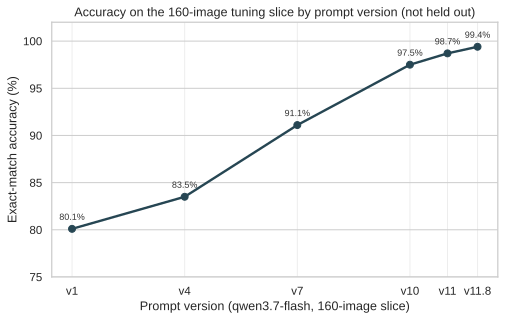
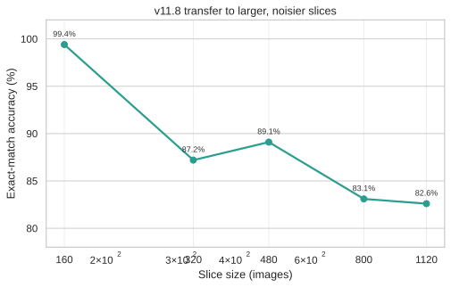
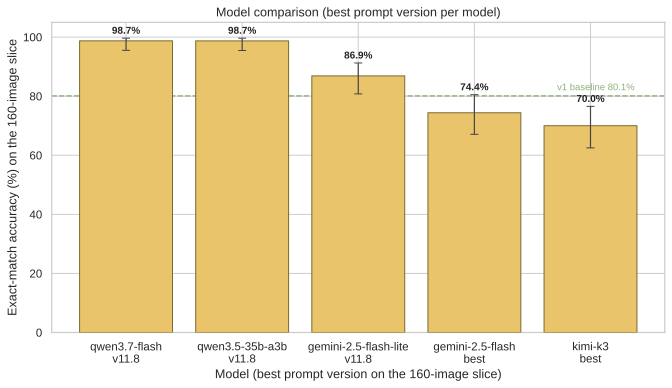
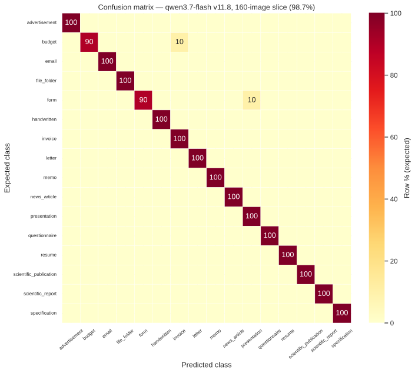
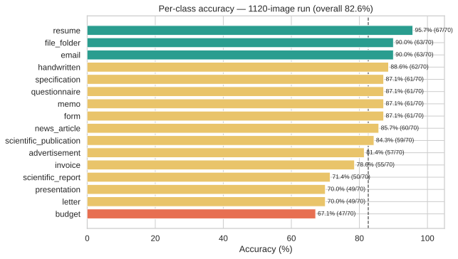
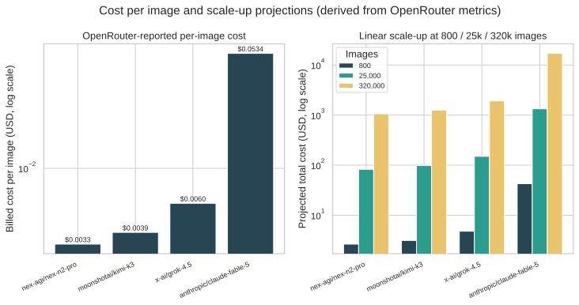
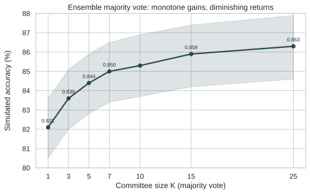
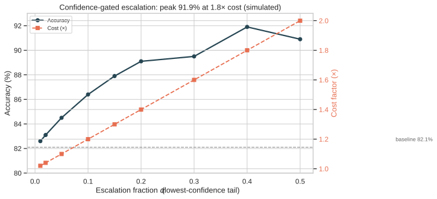
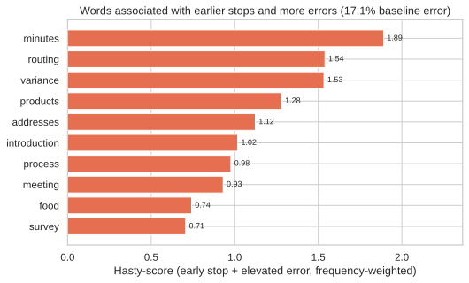

::: {.page}

[← Case study](../rvl-cdip-classifier.qmd){.back}

::: {.project-nav}
[Case study](../rvl-cdip-classifier.qmd) [Technical report](report.qmd){aria-current="page"} [Code](https://github.com/Exios66/RVL-CDIP-Classifier)
:::

# RVL-CDIP-Classifier: technical report {.page-title}

[Zero-shot document classification · prompt engineering · cost and robustness analysis]{.kicker}

## Summary

I tested how well a general-purpose vision model can classify scanned pages into the 16 RVL-CDIP classes using only a written prompt, with no training or fine-tuning. The main model was `qwen/qwen3.7-flash` through OpenRouter. I iterated on the prompt across 29 registered versions.

The number to quote is **82.6% (925 of 1,120)** for prompt v11.8 on a balanced slice of 70 images per class. That slice is a seeded, class-balanced sample of the Hugging Face mirror of RVL-CDIP, which holds 100 images per class across its three splits. It shares at least 20 images per class (320 in all) with the 800-image slice, so those two results are not independent. I did not verify its overlap with the 160-image slice I tuned on. On the tuning slice the same prompt reaches 99.4% (157 of 158), which I treat as an optimistic upper bound because I wrote rules for individual misses on that slice. Cost is about $0.0004 per image. Simulations of voting and routing looked promising, but none of the three routing tests I measured reproduced the gain.

## System and data

The pipeline has these stages.

| Stage | What it does | Module |
|---|---|---|
| Slice building | Streams a 100-per-class Hugging Face mirror of RVL-CDIP, seeds the sampler, can skip images whose rendered pixels match an exclusion set, writes 1024×1024 grayscale PNGs with white padding | `scripts/datasets/`, `scripts/braintrust/create_braintrust_*_dataset.py`, `src/image_utils.py` |
| Preprocessing (separate tool) | Converts TIFF/PDF pages to 300-DPI grayscale images and extracts OCR text with bounding boxes via Tesseract | `src/document_processor.py` |
| Prompting | Versioned, append-only prompt registry | `src/prompts.py` |
| Classification | Builds a message with the prompt and one image, calls OpenRouter, parses the label and a runner-up | `src/openrouter_classifier.py`, `src/openrouter_utils.py` |
| Evaluation | Exact-match scoring, per-class tables, confusion matrices, near-miss counts, billed cost | `src/evaluation.py`, `scripts/braintrust/` |
| Simulation | Bootstrap analyses of voting, routing and failure handling over a pooled per-image corpus | `src/monte_carlo.py`, `src/routing.py` |

**OCR and 300 DPI.** The 300-DPI conversion and OCR live in `src/document_processor.py`, which is used by the TIFF batch-processing script. The classifier does not call it. `classify_image` states that it sends only the image to the vision model, with no OCR text, and the message builder attaches the page as a base64 `image_url` part. The evaluated images are 1024×1024 grayscale PNGs. An early comparison on the 160-image slice found that full-size 2550×3300 inputs roughly doubled prompt tokens (1,637 to 3,701) with no accuracy gain (74.4% against 73.8%) under the baseline prompt.

**Data.** The 160-image slice (10 per class) is the tuning slice. Larger slices come from the Hugging Face mirror, which holds exactly 100 images per class. The 1,120-image run used a 70-per-class sample, drawn with a fixed seed, from a 1,600-image dataset built from all three mirror splits (train, test and validation). The 800-image slice is the train split, so the two share at least 20 images per class (at least 320). The 1,120-image dataset was not built with an exclusion set, because only 50 images per class lie outside the train split. Slices are class-balanced and seeded. The dataset is RVL-CDIP (Harley, Ufkes and Derpanis, 2015).

## Iteration history

Prompts run from v0, a short baseline, to v19, a variant that tells each call to act as one independent vote in a committee. The default in the code is v17.2. Accuracy below is on the 160-image tuning slice (158 scored rows), which is why it climbs so far.

::: {.timeline}
- **v1** — class definitions only. *80.1% (125/156).*
- **v4** — first disambiguation rules for confusable pairs. *83.5% (132/158).*
- **v7** — presentation cover and slide rules. *91.1% (144/158).*
- **v8.5** — folder-tab rewrite over-corrected cover pages. *88.6%, a regression.*
- **v10** — full ordered check cascade covering every earlier miss. *97.5% (154/158).*
- **v11** — estimate-versus-bill rule for budget and invoice. *98.7% (156/158).*
- **v11.8** — form-versus-budget and memo-versus-letter fixes for the three remaining misses. *99.4% (157/158).*
- **v16** — v11.9 plus two worked examples. *96.2% on the tuning slice, 83.8% and 79.4% on two fresh slices.*
- **v19** — vote preamble added to v18.1. *96.9% (155/160, counting one failed call as a miss).*
:::

Two things stand out. The v10 jump (+6.4 points over v9's 91.1%) came from writing rules for every v9 miss, which is tuning in the strict sense. And the last steps to 99.4% fixed three named images. I also kept a harder 56-row evaluation set made from earlier failures, where v11.8 scored 18 of 56 (32.1%), below v11.7's 20 of 56. I fixed one trade-off and introduced others, so I stopped treating the 160-image slice as evidence of generalization.

## Results

| Run | Prompt | Eval set | Held out from tuning? | Exact match |
|---|---|---|---|---:|
| qwen3.7-flash | v11.8 | 160 (tuning slice) | No (tuning slice) | 157/158 (99.4%) |
| qwen3.7-flash | v11.8 | 320 | No: v10 and v11 failures on this slice informed later rules | 279/320 (87.2%) |
| qwen3.7-flash | v11.8 | 480 (476 scored) | No: superset containing the 160 | 424/476 (89.1%) |
| qwen3.7-flash | v11.8 | 800 | Not the tuning slice | 665/800 (83.1%) |
| qwen3.7-flash | **v11.8** | **1,120 balanced** | **Not the tuning slice; overlap with it not verified. Shares at least 20 images per class (320 in all) with the 800 slice** | **925/1,120 (82.6%)** |
| qwen3.7-flash | v0 | 480 | Control | 332/480 (69.2%) |
| qwen3.7-flash | v0 | 800 | Control | 529/800 (66.1%) |

The like-for-like comparison is the 800-image slice: v0 scored 66.1% and v11.8 scored 83.1%, a gain of 17.0 points on the 800-image slice. I did not check whether that slice shares images with the 160-image tuning slice, so some of its pages may have been seen during prompt iteration. Because the 1,120-image slice shares at least 320 images with the 800-image slice, those two results are not independent. Why accuracy falls with slice size is not proven. Larger slices contain noisier scans and more layout variety, and the v16 report found the same prompt scoring about 13 to 17 points lower on mirror slices than on the 160-image slice. I did not test whether the mirror images are intrinsically harder, so that stays a hypothesis.

**Source conflict.** The experiment log gives v11.8 on the 320 slice as 87.2% (279/320). The per-run report gives 87.11% (277/318 scored). I use the log value so the table matches the figures, and the two differ by under 0.1 points.

**Error structure on the 1,120 run.** Per-class accuracy is lowest for budget (67.1%), letter (70.0%), presentation (70.0%) and scientific report (71.4%), and highest for resume (95.7%). The most frequent confusions are letter as memo (16), budget as invoice (12) and specification as form (9). In 72 misses (6.4% of rows, 36.9% of misses) the correct class was the model's runner-up.

**Other models, 160-image tuning slice.** `qwen3.5-35b-a3b` scored 155/157 (98.7%) with v11.8, `gemini-2.5-flash-lite` 86.9%, `gemini-2.5-flash` 74.4% and `kimi-k3` 70.0%, though the last two ran with earlier prompts, so this is not a controlled comparison.

**Cost.** The 1,120-image run billed $0.4937 against a list-price projection of $0.6815, because about 61 to 63 percent of prompt tokens were cache hits. That is about $0.00044 per image. The v19 run reports an average of $0.000377 per image. Other models I priced from single-image runs cost $0.0033 to $0.0534 per image.

## Figures

{.fig fig-alt="Line chart of exact-match accuracy for prompt versions v1, v4, v7, v10, v11 and v11.8 on the 160-image tuning slice, from 80.1 to 99.4 percent." width="100%"}

{.fig fig-alt="Line chart of v11.8 accuracy against slice size, from 99.4 percent at 160 images down to 82.6 percent at 1,120 images." width="100%"}

{.fig fig-alt="Bar chart with error bars of accuracy on the 160-image slice: qwen3.7-flash 98.7 percent, qwen3.5-35b-a3b 98.7, gemini-2.5-flash-lite 86.9, gemini-2.5-flash 74.4 and kimi-k3 70.0, with a dashed line at the 80.1 percent v1 baseline." width="100%"}

The 98.7% in the third figure and the 99.4% in the first come from two separate runs of the same prompt on the same slice: temperature 0.3 with 159 scored rows (157 correct), and temperature 0.1 with 158 scored rows (157 correct). The gap is one row that failed to return usable content, so the two are consistent.

{.fig fig-alt="Heatmap of expected against predicted class for the 16 classes, with nearly every cell on the diagonal at 100 percent and only a few cells at 10 percent off it." width="100%"}

{.fig fig-alt="Horizontal bar chart of per-class accuracy sorted from budget at 67.1 percent to resume at 95.7 percent, with a dashed line at the 82.6 percent overall accuracy." width="100%"}

{.fig fig-alt="Two log-scale bar charts: per-image cost for four models from about 0.003 to 0.053 dollars, and projected total cost at 800, 25,000 and 320,000 images." width="100%"}

{.fig fig-alt="Line chart of simulated accuracy rising from 82.1 percent with one voter to 86.3 percent with 25 voters, flattening after about K equals 7." width="100%"}

{.fig fig-alt="Chart of simulated accuracy and cost factor against the fraction of images escalated to a stronger model, with accuracy peaking at 91.9 percent and cost reaching 2 times at 50 percent." width="100%"}

### Monte Carlo analyses

The simulations bootstrap from a pooled corpus of 5,599 rows covering 1,512 images from 18 experiments. The older manuscript in the repo still cites 4,641 rows and 14 experiments, so I used the corpus summary, which is newer. The corpus mixes prompt versions (1,759 rows are v0, 2,561 are v11.8), so its baseline of 0.821 is a pooled rate and not the best prompt's accuracy.

- **Voting.** Majority vote over K reads lifts simulated accuracy from 0.821 at K=1 to 0.863 at K=25, with most of the gain by K=7 (0.850). The cost multiplier equals K.
- **Routing, simulated.** Escalating the lowest-confidence 40% to a model assumed to be 90% accurate at 3 times cost gives 0.919 at 1.8 times total cost.
- **Routing, measured.** On a 48-image low-confidence slice, re-running at maximum effort moved accuracy from 0.667 (32 correct) to 0.625 (30). Routing to a different stronger model on the tuning slice also failed to help: v18.1 went from 0.962 to 0.943 and v19 from 0.975 to 0.969, at 7.51 and 7.81 times the cost. The routing check scores only the 159 completed rows, so v19's base is 155 of 159 (0.975) there and 154 of 159 (0.969) after merging. The 96.9% in the iteration history is the same 155 correct, divided by 160 rows because one failed call counts as a miss. The simulation's assumption of a genuinely stronger escalator did not hold in practice.

- **Voting, in detail.** The 95% interval at K=1 is 0.805 to 0.836 and at K=25 is 0.846 to 0.879. Gains differ by class: handwritten rises from 0.841 to 0.908, resume from 0.926 to 0.975 and form from 0.849 to 0.897, while letter moves only from 0.742 to 0.757 and budget from 0.648 to 0.699. Voting helps when errors are random and not when the model is consistently wrong. The method resamples recorded runs, and 945 of the 1,512 images have more than one, so the other images cannot change. Voting has not been tested on a live run.
- **Routing, sensitivity.** The simulated accuracy at 40% escalation is 0.899, 0.919 or 0.939 if the escalated model is 5 points worse than, equal to, or 5 points better than the assumed 90%. At 50% escalation it falls to 0.909, so the curve peaks near 40%. At 10% escalation it is 0.864 at 1.2 times the cost, and at 20% it is 0.891 at 1.4 times.
- **Routing, verification.** The paired check on the 48 low-confidence images found a base accuracy of 0.667, against a simulated mean of 0.425 for the same images and a pooled 0.821, so the confidence ranking did pick out harder pages. The routed run on the v19 tuning slice sent 15 pages to `gemini-2.5-pro`. One prediction changed, to a wrong label, and the escalated run got 14 of those 15 pages right. The merged accuracy was 0.969 against 0.975, at 7.81 times the cost.
- **Prompt ablation.** A paired bootstrap of 10,000 resamples compares prompt versions on the images they share. v0 to v11.8 on 898 shared images goes from 0.732 to 0.862, a gain of 13.0 points (95% interval 10.1 to 15.9). v0 to v17 goes from 0.677 to 0.961 on 155 images, a gain of 28.4 points, but those are tuning-slice images, so it overstates the gain. Between tuned versions the results are inconclusive: v11.8 against v16 on 319 shared images is 0.890 against 0.900 (interval -0.053 to +0.034), and v16 against v17 on 159 is 0.969 against 0.962. v11.8 against v17 favors v11.8 (0.987 against 0.962) with an interval that just touches zero. Per-class differences rest on about 10 images each and have wide intervals.
- **Exemplar mining.** The simulation targeted 12 of the 110 confusion pairs with four few-shot exemplars, and estimated that 32.8 of 767 corpus errors (4.27%) would flip. The measured run on a 48-image slice moved from 0.688 (v17.2) to 0.646 (v18), a drop of 4.2 points with no gain.
- **Failure model.** First-attempt success was fitted at 0.946, with length truncation at 0.021 and transient, rate-limit and quota errors at zero. The recorded runs failed on 2.716% of rows. Simulating the pipeline with a fallback model gives 0.114%, and without one about 2.86% to 2.94% at any retry count from 1 to 5, so the fallback matters and extra retries do not. Extrapolated, that is about 28 failures per 25,000 images (interval 19 to 39) and 364 per 320,000 (interval 328 to 402). This is a model of the pipeline and I have not confirmed it on a live run.
- **Reasoning-trace analysis.** Of 1,913 rows with reasoning, 1,832 traces parsed into the prompt's checks and 1,301 stop explicitly. The mean stop is at check 9.4 of 14 and the error rate is 17.1%. Words quoted in the stopping evidence are scored by how much earlier the stop comes and how much the error rate rises, weighted by frequency. "minutes" (11 traces, 82% error), "routing" (10 traces, 90%) and "variance" (10 traces, 100%) score highest. The counts are small, so these are leads and not findings.
- **Confusion pairs.** In the pooled corpus the largest are budget read as invoice (63), letter as memo (63), specification as form (52), invoice as form (51), budget as form (40) and handwritten as letter (34).

{.fig fig-alt="Horizontal bar chart of the ten words with the highest hasty-score, from minutes at 1.89 down to survey at 0.71, with routing, variance, products, addresses, introduction, process, meeting and food between them." width="100%"}

### Data exploration and observability tools

These are in the repository and are linked from the case study as well.

| Tool | What it does | Where |
| --- | --- | --- |
| Quarto site | Manuscript, methods, results, experiment log, prompt changelog, cost analysis, research memos, notebooks and a misclassification appendix. Renders offline, with no model spend. | [`website/`](https://github.com/Exios66/RVL-CDIP-Classifier/tree/main/website) |
| Monte Carlo pages and reports | Ten pages and the raw tables for the analyses above. | [`website/montecarlo/`](https://github.com/Exios66/RVL-CDIP-Classifier/tree/main/website/montecarlo), [`reports/monte_carlo/`](https://github.com/Exios66/RVL-CDIP-Classifier/tree/main/reports/monte_carlo) |
| Interactive pages | A cost calculator and an experiment explorer. | [`website/interactive/`](https://github.com/Exios66/RVL-CDIP-Classifier/tree/main/website/interactive) |
| Data exploration | Class balance, image dimensions, file sizes, color modes and sample grids. | [`scripts/eda/`](https://github.com/Exios66/RVL-CDIP-Classifier/tree/main/scripts/eda) |
| Braintrust tooling | Dataset builders, evaluation runs logged as Braintrust experiments, summaries, reports, metric charts, and the Monte Carlo scripts. | [`scripts/braintrust/`](https://github.com/Exios66/RVL-CDIP-Classifier/tree/main/scripts/braintrust) |
| Notebooks | Setup, balanced sampling and upload, evaluators over a full experiment, and cost. | [`notebooks/`](https://github.com/Exios66/RVL-CDIP-Classifier/tree/main/notebooks) |

## Reproducibility

The environment needs Tesseract and Poppler for the preprocessing tool, plus an OpenRouter key in a local `.env` file.

```sh
pip install -r requirements.txt
cp .env.example .env   # add OPENROUTER_API_KEY
python scripts/datasets/create_balanced_dataset.py
python scripts/openrouter/estimate_openrouter_cost.py
python src/openrouter_classifier.py
```

Slices are rebuilt with fixed seeds (default 42, other slices 1738, 2303 and 9413), so the same source reproduces the same images. Prompt text is versioned in `src/prompts.py`, and each experiment's final report, confusion matrix and manifest are committed under `reports/`. The model runs through a hosted API, so results are point-in-time. A provider-side change could shift them.

## Engineering quality

The test suite has 318 test functions in 21 files, covering the document processor, prompt registry, classifier and message builder, evaluation and report accounting, routing, Monte Carlo code and dataset builders. Evaluation uses exact match, with a failed or empty response counted as a miss, so API failures lower the score and are not hidden. The v16 report attributes 16 of 480 rows to length truncation and provider errors, and the report proposed a higher token cap. Reports record billed cost per row.

## Limitations and next steps

- **Tuning contamination.** The 99.4% figure is on the slice I tuned against. I cannot rule out that some mirror images in the larger slices appeared in failure-driven evaluation sets, so 82.6% is a different slice from the tuning slice, not a verified-clean test set. The 1,120-image slice was not built with an exclusion set: it is a 70-per-class sample of the 100-per-class mirror, so it shares at least 20 images per class with the 800-image slice. I did not check it against the 160-image tuning slice.
- **Mirror, not the full test set.** All numbers are from small balanced slices of a 100-per-class mirror. They are not the 40,000-image RVL-CDIP test set, and they are not comparable to published supervised results.
- **Bundled edits.** Each prompt version changes several things at once, so I cannot attribute gains to individual rules.
- **Single main model.** Cross-model results are not controlled, and statistical power on 160 images is low.
- **Untested fixes.** Next steps are a prompt-ablation study on the large slices, and testing whether the 13-to-17-point gap between curated and mirror slices comes from image quality or from label noise.

## Credits

Built with co-author Grant Mooslin, advised by Siddharth Suresh. Dataset: RVL-CDIP (Harley, Ufkes and Derpanis, 2015).

:::
