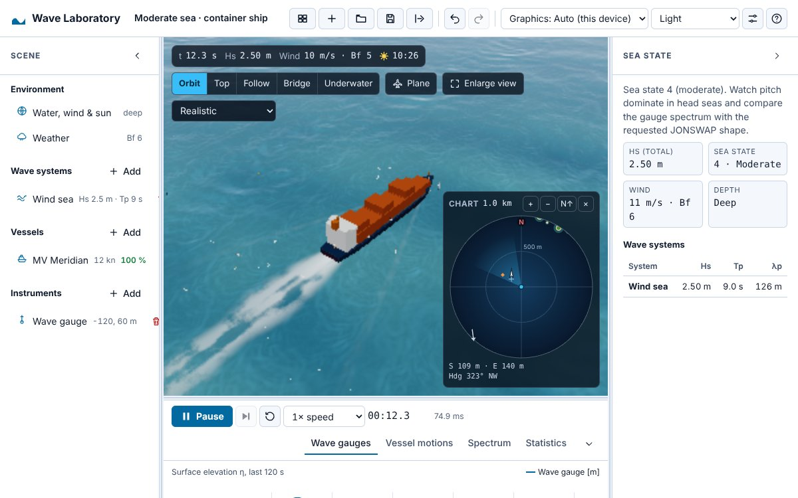
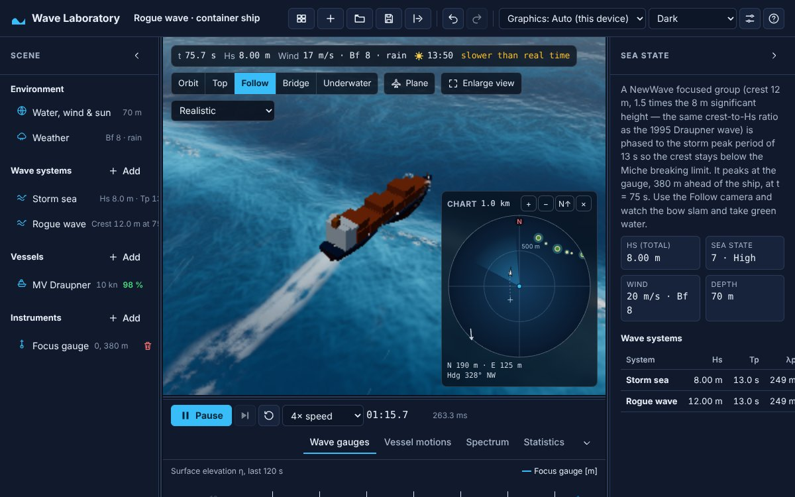
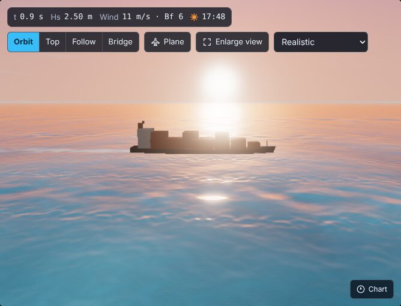
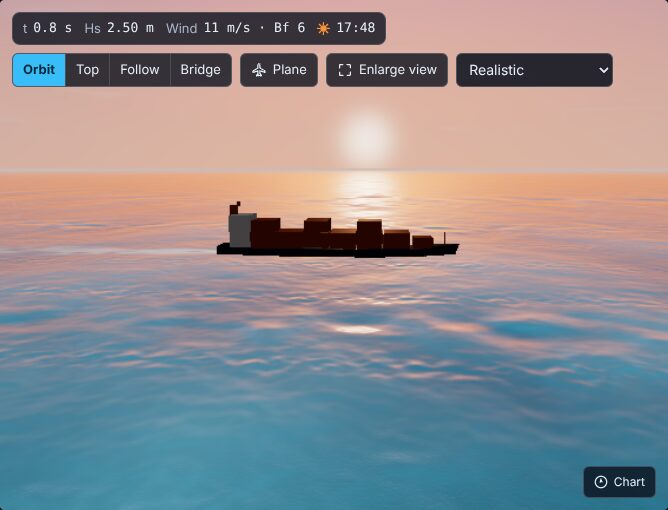
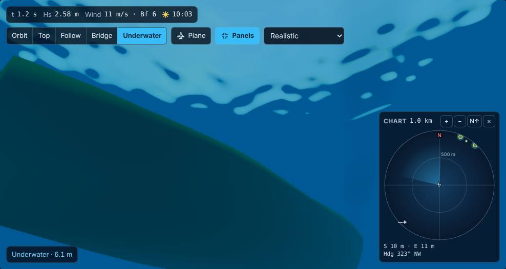

::: {.page}

[← All projects](index.qmd){.back}

::: {.project-nav}
[Case study](wave-laboratory.qmd){aria-current="page"} [Technical report](wave-laboratory/report.qmd) [Appendix](wave-laboratory/appendix.qmd) [Code](https://github.com/Exios66/wave-laboratory) [Live demo](https://exios66.github.io/wave-laboratory/)
:::

# Wave Laboratory {.page-title}

[Side project · simulation & graphics]{.kicker}

::: {.actions}
[Launch the lab](https://exios66.github.io/wave-laboratory/){.btn .primary}
:::

The lab needs a browser with WebGL 2. It runs on desktop and on phones.

## At a glance

::: {.stats}
::: {.stat}
[4]{.stat-value} [FFT cascades, from 1 km swells down to centimetre ripples]{.stat-label}
:::
::: {.stat}
[280]{.stat-value} [water columns, at most, sampled under a hull to integrate pressure]{.stat-label}
:::
::: {.stat}
[472 + 25]{.stat-value} [`it(` calls in 61 src test files, plus 25 validation tests, on 4c7354e]{.stat-label}
:::
:::

## The problem

I have always liked how much of the sea can be written as a short recipe. A real ocean is not one wave. It is thousands of simple waves of different lengths and directions added together, and oceanographers describe how much energy each one carries with a curve called a spectrum. Ships respond to that sum, not to any single wave.

I wanted a place to build a sea from those published recipes, drop ships into it, and watch and measure what happens, with the physics honest enough that the numbers mean something and the page still running smoothly in a browser tab.

## Approach



The sea is built from named, published models. The energy curve comes from JONSWAP, Pierson–Moskowitz or Bretschneider spectra, with a depth correction (TMA) for shallow water and Hasselmann's fetch-limited growth for seas built by wind. Waves are spread over directions, and the speed of each wave follows the dispersion relation, including water depth and surface tension. The surface is then synthesised with an inverse FFT on four grids of different sizes, with a "choppy" sideways displacement that sharpens crests.

Ships float by pressure integration: for each moment, the simulation sums the water pressure over the part of the hull that is underwater (buoyancy plus the Froude–Krylov wave force), then adds added mass, damping, propulsion, rudder and wind. A freak wave can be placed on purpose using NewWave theory, which lines up many components so their crests meet at one point and time. The Draupner crest, 18.5 m in a sea with a significant height of 11.9 m, is the reference case.

## What I built

- **Deterministic simulation.** The same experiment file always produces the same sea. Physics runs at a fixed time step in a Web Worker, and the main thread keeps at most one request in flight, so a slow machine runs slower than real time rather than building a queue.
- **What you see is what the ships feel.** The GPU draws the sea from the same amplitudes the CPU physics uses. On each new sea it compares one texel with the CPU result and logs an error if they disagree. The browser tests fail if that error appears.
- **Instruments.** Wave gauges, ship motion recorders, power spectra by Welch's method, wave statistics, motion-sickness incidence and CSV export.
- **Underwater view.** Light fades per colour with depth for the chosen Jerlov water type, and the surface seen from below shows Snell's window.
- **Weather, damage and moorings.** Gusts, squalls, rain and fog; flooding compartments; anchor chains modelled as elastic catenaries.
- **Phones and accessibility.** A phone layout with panel switching and touch targets of at least 44 px, except the camera controls drawn on top of the 3D view, which stay shorter so they do not cover the sea (the stylesheet sets them to 32 px). It also has light and dark themes, keyboard operation and WCAG 2.2 AA contrast. Accessibility is checked with axe in the browser tests on desktop and phone-sized viewports.

## Results

{.fig fig-alt="The Wave Laboratory app in its light theme. A container ship leaves a white wake on a blue-green sea in the central 3D view, with a round chart overlay. A scene list is on the left, a sea-state panel with significant wave height, wind and depth is on the right, and playback controls and chart tabs run along the bottom." width="100%"}

{.fig fig-alt="The app in its dark theme following a container ship through a rough blue sea with white wake and rain. The sea-state panel explains a focused wave group with a 12 m crest in an 8 m significant-height sea, peaking at t = 75 seconds." width="100%"}

{.fig fig-alt="A container ship seen from low over a pink and orange sunset sea. A bright sun glows near the horizon and a column of glare runs down the water toward the viewer. Controls for camera mode and view size sit at the top." width="100%"}

{.fig fig-alt="The same container ship and sunset sea as the previous view, but the sun is a smaller, crisper disc with no glow spreading across the ship, and the water glints less strongly." width="100%"}

{.fig fig-alt="A view from under the water. A dark green ship hull runs diagonally across the lower left. Above it, the bright rippled underside of the sea surface shows foam patches against deep blue water. A small round chart sits at the lower right." width="100%"}

{.fig fig-alt="An underwater view in which everything is tinted dark green, with slightly lighter and darker patches. No hull is visible, and a chart panel sits at the lower right." width="100%"}

::: {.caveat}
**Heads up.** This is a teaching and exploration tool, not a certified seakeeping program. The reference notes list what is not modelled, such as current shear with depth, wave refraction by currents, and floodwater sloshing. The technical report covers these limits.
:::

## What I learned

- Putting the sea's recipe in one place, then reading it from both the CPU and the GPU, made disagreements easy to find and fix.
- A test that fails when the two sides disagree is worth more than careful reading.
- Writing down what a model does not cover, and warning the user when they leave its range, is part of the physics.
- Accessibility checks in the browser tests caught issues I would not have found by eye.

## Stack

[TypeScript]{.tag} [React]{.tag} [Three.js]{.tag} [WebGL 2]{.tag} [Web Workers]{.tag} [Zod]{.tag} [Zustand]{.tag} [Vite]{.tag} [Vitest]{.tag} [Playwright]{.tag} [axe-core]{.tag}

:::
