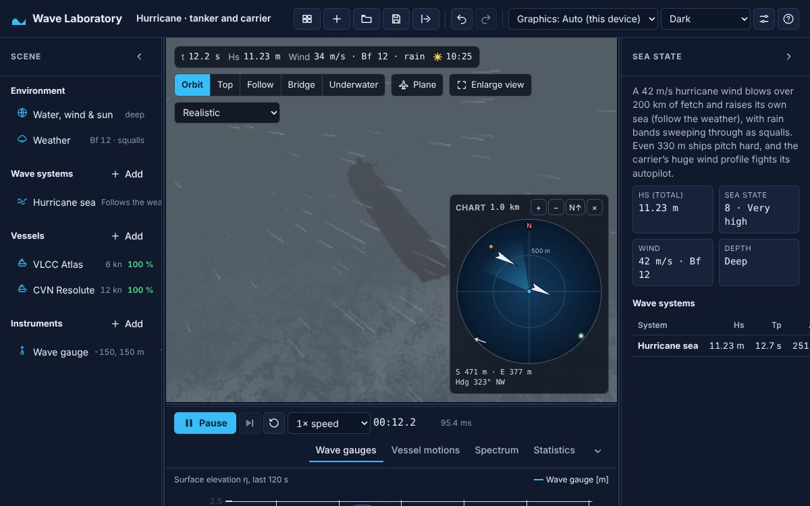

::: {.page}

[← Case study](../wave-laboratory.qmd){.back}

::: {.project-nav}
[Case study](../wave-laboratory.qmd) [Technical report](report.qmd){aria-current="page"} [Code](https://github.com/Exios66/wave-laboratory) [Live demo](https://exios66.github.io/wave-laboratory/)
:::

# Wave Laboratory: technical report {.page-title}

[Side project · simulation & graphics]{.kicker}

::: {.actions}
[Launch the lab](https://exios66.github.io/wave-laboratory/){.btn .primary}
:::

## Summary

Wave Laboratory is a browser-based ocean-wave and ship-motion sandbox: it builds a sea state from oceanographic spectra, synthesises the surface with FFTs, floats 6-degree-of-freedom ships in it and records the results with virtual instruments. It is a personal project under the MIT license, version 0.1.0. It needs Node 22 or later to build and a browser with WebGL 2 to run. The conventions in `docs/PHYSICS.md` are the single source of truth for both the CPU physics and the GPU renderer; the document states that if code and file disagree, that is a bug.

This is a simulation tool. It has been checked against analytic and textbook results, listed below, and not against measurements from a wave tank or sea trial.

## System and data

### Physics models

**Linear waves.** Dispersion is ω² = (g k + (σ/ρ) k³) tanh(k h), with finite depth h and surface tension σ. Dynamic pressure attenuates with depth by cosh(k(z+h)) / cosh(kh). Below the surface, pressure uses Wheeler stretching.

**Spectra.** Each wave system has an energy spectrum, a directional spreading function and a seed. The table gives what is implemented.

| Model | Role | Key parameters and notes |
| --- | --- | --- |
| JONSWAP | Developing wind sea | α, peak frequency ω_p, peak enhancement γ (3.3 used for focused groups), σ = 0.07 below and 0.09 above the peak; normalised so 4√m₀ = H_s |
| Pierson–Moskowitz | Fully developed sea | JONSWAP with γ = 1, normalised to H_s |
| Bretschneider | Two-parameter sea | Same family as above, normalised to H_s |
| TMA | Finite-depth correction | Kitaigorodskii depth factor, applied when depth is under 1000 m; H_s re-normalised |
| Hasselmann et al. (1973) | Fetch-limited wind sea | Growth with fetch, capped at the fully developed limit, H_s ≈ 0.209 U²/g |
| Regular (Airy) | Single analytic wave | η = a cos θ; a second-order Stokes harmonic is added when choppiness is above zero |
| NewWave (Tromans et al. 1991) | Focused rogue group | 40 linear components between 0.6 ω_p and 3 ω_p, phased so crests coincide at a chosen place and time |

Directional spreading is one of cos-2s, Mitsuyasu (frequency dependent) or Donelan–Banner sech², each normalised so the integral over direction is 1. A uniform surface current Doppler-shifts the whole sea.

**Surface synthesis.** The surface is a sum of four periodic cascades with sizes 1024, 256, 64 and 16 m. The first three are evaluated by the CPU physics on 128 by 128 grids; the fourth runs to the grid limit and is visual only. Initial amplitudes h₀(k) are made once on the CPU from a counter-based hash of the system seed, cascade and wavenumber index, so every grid resolution sees the same sea. Horizontal choppy displacement uses a choppiness factor, and the Jacobian of the displacement flags folding: J below zero marks a breaking crest, which drives foam.

**Rogue waves.** A focused wave adds to the background sea, so the crest at the focus sits above it by the chosen crest amplitude. The inspector compares the equivalent steepness with the Miche limit, 0.142 tanh(kh). The note records Draupner as 18.5 m over 11.9 m, a crest-to-H_s ratio of 1.55, in a typical recorded range of 1.2 to 1.6.

**Ships.** Hull forces come from integrating pressure over the instantaneous wetted hull, as hydrostatics plus Froude–Krylov, sampled on up to 280 water columns. Added mass uses strip theory with Lewis-form sections and a three-dimensional end reduction. Radiation damping is tuned to 15 per cent of critical in heave and pitch, and roll damping follows an Ikeda-type decomposition. Wind acts through frontal and lateral areas with drag coefficients of 0.7 and 0.9. Square sails, flooding through watertight compartments with free-surface loss of stability, and an elastic catenary anchor line are modelled; each has its own section in the physics note.

**Weather.** Gusts come from 24 Fourier modes drawn from a von Kármán spectrum, carried downwind as frozen turbulence. Whitecap coverage follows Monahan and O'Muircheartaigh (1980), visibility follows Koschmieder's law with a rain term, and lightning is visual only.

**Instruments.** Welch's method gives spectra from Hann-windowed segments with 50 per cent overlap, scaled so the integrated density equals the signal variance. Zero-up-crossing statistics follow IAHR and PIANC conventions. Motion-sickness incidence follows O'Hanlon and McCauley (1974).

**Underwater optics.** Jerlov water types give diffuse attenuation coefficients K_d for red, green and blue. They drive rendering only, not the physics. Light is attenuated as c·e^(−K_d·d) plus in-scattered colour, and from below the surface shows the rippled sky inside Snell's window (48.6°) and a mirror outside it.

### Architecture

The main thread runs the React UI, a Zustand store and the renderer. A Web Worker runs the simulation: the CPU ocean field, the vessels and a fixed-rate recorder. `SimClient` keeps one request in flight. Edits go through a Zod-validated store, which also keeps undo history and bumps a revision that reloads the worker.

| Stage | Module path |
| --- | --- |
| Maths, RNG, fixed-step clock, units | `src/core/` |
| Experiment schema (Zod) and presets | `src/schema/` |
| Dispersion, spectra, spreading, cascades, CPU FFT | `src/ocean/` |
| Hulls, hydrostatics, hydrodynamics, wind, sails, flooding, mooring | `src/vessel/` |
| Gusts, squalls, rain, lightning | `src/weather/` |
| Welch PSD, statistics, MSI | `src/instruments/` |
| Simulation kernel, worker, client | `src/sim/` |
| WebGL 2 renderer, GPU FFT ocean, post stack, underwater pass | `src/render/` |
| React application | `src/ui/` |

Only `src/render` imports Three.js. The renderer is the sole GPU dependency and is isolated behind `render/api.ts`.

Performance budget at default settings: one CPU ocean snapshot (three cascades, six 128 by 128 FFTs each) takes about 15 ms in the worker at 20 Hz, and a vessel step takes under 1 ms per vessel at 120 Hz. The GPU FFT (four cascades at 256 by 256) takes a few milliseconds.

### The GPU and CPU cross-check

The GPU inverse-FFTs the same h₀ amplitudes the CPU uses. On each new sea the renderer reads one texel back, compares it with the CPU transform and calls `console.error` on a mismatch, which `e2e/app.spec.ts` fails on. Devices without 32-bit float render targets use half-float and skip the readback. The GPU draws only elevation and horizontal displacement; slope, Jacobian and foam are finite differences of the displaced surface, and pressure and orbital velocity stay on the CPU.

## Iteration history

The repository has 131 commits, from 2026-10-01 to 2026-10-08. The plan document's status table lists what shipped in v0.1.

::: {.timeline}
- **Core** — tooling, schema, deterministic fixed-step core. *Shipped.*
- **Ocean** — spectra, wind-sea growth, spreading, four cascades, choppy displacement, regular waves, CPU reference and GPU. *Shipped.*
- **Vessels** — pressure integration with waterline clipping, radiation, viscous drag, propulsion, rudder and autopilot. *Shipped.*
- **Damage, moorings, instruments, UI** — flooding, anchors, Welch PSD, MSI, CSV export, presets, share links, phone layout. *Shipped.*
- **Rendering extras** — HDR post stack with bloom, underwater camera with Snell's window. *Shipped.*
:::

## Results

There are no benchmark numbers against external data. The evidence is the validation suite below.

### Validation suite

The longer statistical checks live in `*.validation.ts` files and run with `pnpm validate`, with a 120-second timeout per test. There are 9 files and 25 test definitions.

| File | What it checks |
| --- | --- |
| `ocean/ocean.validation.ts` | A virtual wave gauge reproduces the requested JONSWAP spectrum; linear seas have Gaussian elevations and H1/3 close to Hm0; choppy seas show positive skewness (sharper crests) |
| `sim/rogue.validation.ts` | A 12 m NewWave crest peaks at the focus gauge near t = 75 s and the ship ships green water |
| `vessel/vessel.waves.validation.ts` | Heave RAO close to 1 for 20 s head seas; slamming and green water in steep head seas |
| `vessel/vessel.manoeuvring.validation.ts` | Plausible steady speeds, 30° autopilot turns without large overshoot, rudder sign and rate limit |
| `vessel/vessel.wind.validation.ts` | Leeway and heel in a beam wind, carrier course holding, square-rig sailing, reefing in a storm |
| `vessel/flooding.validation.ts`, `damage.validation.ts` | Flooding and damage behaviour, including Torricelli decay and flooded-barge roll period |
| `vessel/mooring.validation.ts` | A trawler in a 15 m/s wind settles at a chain pull of 3.9 kN against a 3.8 kN wind load; a cargo ship stays within its watch circle in a 2 m swell; the anchor drags in a 45 m/s gale |
| `vessel/vessel.perf.validation.ts` | Performance check |

The physics note also records that the simulated roll period of a flooded barge matches the closed-form value within 1 per cent, and that the elastic catenary was compared with a direct numerical integration of the governing equations for three stiffnesses.

### Test counts

These are counts of test definitions found by grep, not a run result. I did not run the suite for this report, so I make no pass-rate claim.

| Suite | Count | Where |
| --- | --- | --- |
| Unit | 328 definitions in 44 files | `src/**/*.test.ts` |
| Validation | 25 definitions in 9 files | `src/**/*.validation.ts` |
| Browser (Playwright) | 24 definitions in 2 files: 19 desktop, 5 mobile | `e2e/app.spec.ts`, `e2e/mobile.spec.ts` |

The grep counts `it(` and `test(` at the start of a line, so parametrised and template-generated tests are undercounted. The Playwright config defines desktop Chromium at 1440 by 900, a Pixel 7 profile and an iPhone 14 viewport, so each browser test can run several times.

## Figures

{.fig fig-alt="The app in light theme: a container ship with a white wake on a blue-green sea, scene list on the left, sea-state panel on the right and playback controls below." width="100%"}

{.fig fig-alt="The app in dark theme in a hurricane. Rain streaks across a grey sea, a dark hull is faintly visible, and the sea-state panel reports an 11.23 m significant height and sea state 8." width="100%"}

{.fig fig-alt="Dark theme view following a container ship through a rough sea. The side panel explains a 12 m focused crest in an 8 m significant-height sea peaking at 75 seconds." width="100%"}

{.fig fig-alt="A view from underwater: a smooth wash of blue light with no hull or seabed in frame, a depth badge reading 4.0 m and a round chart panel at lower right." width="100%"}

{.fig fig-alt="A dark green hull runs diagonally across the lower left under a bright rippled surface with foam patches." width="100%"}

{.fig fig-alt="A dark hull edge cuts diagonally across the lower left. Above it the underside of the sea surface shows pale blue light with dark foam patches against deep blue water." width="100%"}

{.fig fig-alt="An entirely dark green underwater view with faint lighter and darker patches and a chart panel at lower right." width="100%"}

{.fig fig-alt="A container ship on a sunset sea with a large glowing sun and glare spreading over the ship and water." width="100%"}

{.fig fig-alt="The same sunset view with a smaller, crisper sun and no glow across the ship." width="100%"}

## Reproducibility

```sh
pnpm install
pnpm dev            # http://localhost:5173
pnpm test           # unit tests
pnpm validate       # longer statistical physics validation
pnpm build && pnpm test:e2e   # browser tests on desktop and phone viewports
pnpm check          # format, lint, typecheck, unit tests and build
```

Experiments are deterministic: the same saved file produces the same sea, because amplitudes are seeded per cell with a counter-based hash and the physics advances in exact fixed steps. Tools are pinned in `package.json` and `pnpm-lock.yaml`: for example Three.js ~0.186.1, Playwright 1.56.1 and TypeScript 5.9.3. The package manager is pnpm 10.28.0.

The live demo is the production build committed to `docs/` on `main` by `pnpm deploy:pages` and served by GitHub Pages from a branch. There are no GitHub Actions workflows. The build uses relative asset paths, so it runs from any static host.

## Engineering quality

- **Types and lint.** Strict TypeScript, ESLint with jsx-a11y and Prettier.
- **Accessibility.** Axe-core runs with WCAG 2.0, 2.1 and 2.2 A and AA tags on the desktop app, in both themes and with a dialog open, and on phone viewports. The 3D view is keyboard operable, and everything it shows is also available as text. Colour tokens meet AA contrast in both themes.
- **Phones.** Below 900 px the scene, inspector and dock share one cell; the browser tests check no horizontal overflow, touch editing and the More menu on a Pixel 7 and an iPhone 14 in both orientations. Touch targets are at least 44 px on touch devices, with one exemption: the camera and overlay controls drawn on top of the 3D view stay shorter (32 px in the stylesheet) so they do not cover the sea. Range sliders are 36 px.
- **Contracts.** Plain TypeScript interfaces separate vessels, renderer and simulation.
- **Robustness.** A lost WebGL context is rebuilt, and phones and software renderers use a coarser mesh.

## Limitations and next steps

What the physics note says is not modelled or is simplified:

- Current: no refraction by current gradients, no shear with depth, no wave steepening against an opposing current. The inspector warns when an opposing current exceeds half the peak group velocity, and again past blocking.
- Flooding: no sloshing dynamics, no cross-flooding time, 100 per cent permeability, floodwater adds weight but not inertia, one lumped breach per compartment.
- Moorings: quasi-static line with no snap loads, frictionless flat seabed, anchor holding independent of line angle.
- Waves: the Stokes second-order term is capped, and the shallow-water regime beyond Stokes validity is not covered. The fourth cascade is visual only, and the GPU draws a subset of the CPU fields.
- Weather: gusts and squalls act on vessels and the picture, not on the wave spectrum. Lightning is visual only.
- The hull model is strip theory at the lowest fidelity tier, not a panel or CFD code.
- Underwater optics are for rendering and do not feed the physics.

### Plan versus shipped

The master plan (last updated 2026-10-02) proposed raw WebGPU. The shipped renderer uses WebGL 2 through Three.js, because every current browser supports it and the renderer is isolated behind an interface so a WebGPU backend could follow. The plan also had vessels read the GPU surface back. The shipped design samples a CPU evaluation of the same spectral components in the worker, which keeps physics deterministic and testable in Node. The plan's later phases are not built: Stokes and cnoidal waves, grid shallow-water and Boussinesq solvers, a scripting API, and higher-fidelity radiation. The plan also describes a "Reference" CPU float64 mode that I have not verified as shipped.

:::
